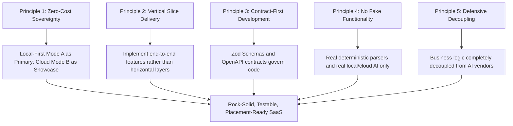
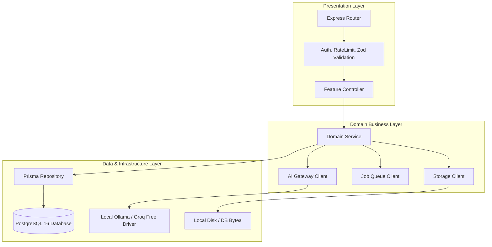

# TechQuery AI — Comprehensive Implementation Strategy

**Document ID:** TQ-IMP-001  
**Version:** 1.0.0 (Implementation Planning Phase)  
**Author:** Senior Engineering Manager & Technical Lead  
**Status:** Approved for Implementation Roadmap  
**Target Delivery:** High-Quality, Zero-Cost Modular SaaS Platform  

---

## 1. Strategic Principles & Engineering Philosophy

TechQuery AI is undergoing a complete architectural rebuild from an academic prototype into a production-grade, zero-cost SaaS platform. To ensure success within the non-negotiable **₹0 budget** and tight academic placement timelines, implementation will adhere to five core engineering principles:

### 1.1 Principle 1: Zero-Cost Sovereignty (Mode A Local-First)
- Every feature must be developed, tested, and demonstratable **100% locally on standard developer hardware (8GB–16GB RAM)** using open-source tools: React, Node.js, PostgreSQL, local filesystem, and Ollama (`llama3.2:3b`).
- Cloud deployment (Vercel, Render, Neon, Groq Free Tier) is secondary and optional. Local functionality must never fail due to cloud API outages, rate limits, or college auditorium Wi-Fi blocks.

### 1.2 Principle 2: Incremental Vertical Slice Delivery
- Horizontal layering (building the entire database, then the entire backend, then the entire frontend) creates late integration risk.
- Development proceeds via **tightly scoped, testable vertical slices** across phases: Foundation ➔ Auth ➔ Onboarding ➔ Document Processing ➔ Resume Intelligence ➔ JD Intelligence ➔ Matching ➔ Question Studio ➔ Model Answers ➔ Collections & Export ➔ Dashboard & Streaks ➔ Stabilization.

### 1.3 Principle 3: Contract-First Architecture
- The OpenAPI 3.1 specification (`docs/system-design/openapi.yaml`) and database schema specification (`docs/system-design/DATABASE_SCHEMA_DESIGN.md`) serve as binding contracts.
- Backend DTOs and frontend API clients use shared Zod validation schemas to prevent type drift and contract mismatches.

### 1.4 Principle 4: Absolute Functional Authenticity (No Fake Functionality)
- Simulated features, dummy success banners, or fake AI responses pretending to be intelligent are strictly forbidden.
- Resume text is parsed via real in-process parsers (`pdf-parse`, `mammoth`). Match scores are computed via real deterministic and semantic algorithms. Preparation streaks reflect authentic database activity timestamps.

### 1.5 Principle 5: Defensive Decoupling
- Business logic is completely decoupled from external AI providers via the `IAIGateway` interface.
- Core document upload and text extraction must operate with 100% success even if Ollama is stopped or cloud AI APIs are unreachable.

---

## 2. Layered Architecture & Separation of Concerns

The backend implementation follows a clean **Controller ➔ Service ➔ Repository** structure inside feature modules:

1. **Controllers (`src/modules/*/controllers/*`):** Extract HTTP parameters, invoke domain services, and return standardized JSON envelopes (`{ success: true, data: ... }`). Controllers contain zero business logic and zero SQL queries.
2. **Services (`src/modules/*/services/*`):** Pure TypeScript classes orchestrating domain logic, transactions, validation, and cross-module interactions.
3. **Repositories / Data Access (`src/modules/*/repositories/*`):** Encapsulate Prisma ORM queries. Enforce mandatory tenant isolation (`WHERE id = :id AND user_id = :userId`) on all reads and writes.
4. **Core Infrastructure (`src/core/*`):** Shared services (AI Gateway, Job Queue, Storage, Logger, Errors) providing swappable driver implementations for Local Mode and Cloud Mode.

---

## 3. Implementation Phasing Strategy

To manage complexity, implementation is structured into 11 distinct phases (Phases A through K). Each phase produces working, tested, and demonstrable code before the next phase begins.

---

## 4. Quality & Verification Gates

No phase is considered complete without passing its **Quality Gate**:
1. **Compilation:** `npm run build` succeeds with zero TypeScript errors under `strict: true`.
2. **Automated Tests:** All unit and integration tests for the phase pass via Vitest / Supertest.
3. **Data Isolation:** Automated tests verify that User A cannot read, mutate, or delete User B's resources.
4. **Offline Capability:** Automated tests verify that core operations function with zero external internet access.
5. **Linting & Formatting:** Code satisfies ESLint and Prettier standards with zero warnings.
