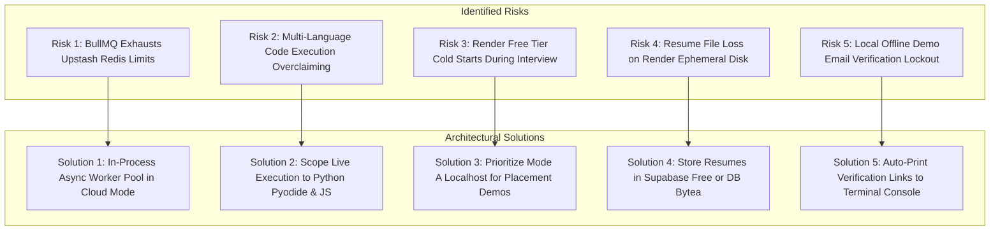

# TechQuery AI — Technical Risks & Engineering Recommendations

**Document ID:** TQ-AUDIT-006  
**Audit Date:** 2026-11-21  
**Auditor:** Senior SaaS Solutions Architect & Systems Engineer  
**Scope:** Critical Technical Risks, Operational Vulnerabilities, and Actionable Remediation  

---

## 1. Top 5 Critical Technical Risks & Solutions

---

### Risk 1: BullMQ Polling Overwhelms Upstash Redis Free Tier (10k Commands/Day)
- **Technical Vulnerability:** BullMQ workers continuously poll Redis using `BRPOPLPUSH` or recurring timer loops to inspect queue states. Over an external network, an active BullMQ worker makes hundreds of polling requests per hour, burning Upstash's 10,000 daily command quota within hours—even when no jobs are queued. Once the quota is exhausted, Upstash blocks all subsequent commands with HTTP 429, breaking rate limiting and background processing.
- **Severity:** **CRITICAL**
- **Actionable Recommendation:**
  1. **Do not use BullMQ on Upstash Redis in Cloud Mode.**
  2. Implement an **In-Process Concurrency-Limited Queue (`p-limit` / `async-mutex`)** or a **PostgreSQL-backed Job Queue Table (`status = PENDING`, `FOR UPDATE SKIP LOCKED`)** for the cloud deployment on Render.
  3. Reserve Upstash Redis strictly for fast sliding-window rate limiting and session validation (which consume only ~1 command per API hit).
  4. Local Mode can continue using local Redis + BullMQ without restriction.

---

### Risk 2: Overclaiming Multi-Language Code Execution without Server Infrastructure
- **Technical Vulnerability:** The original feature specification claimed interactive execution for Python, JavaScript, Java, and C++. Running Java (JVM) and C++ (native compilation) in a browser without server-side execution requires complex, unstable, and heavy WebAssembly runtimes that frequently fail on standard libraries. Running Docker containers on free 512MB cloud instances causes immediate out-of-memory crashes.
- **Severity:** **HIGH**
- **Actionable Recommendation:**
  1. Clearly bifurcate the Coding Practice module into **Code Execution** vs **Code Practice/Review**.
  2. **Python:** 100% interactive execution powered client-side by **Pyodide (WebAssembly)** running in a Web Worker.
  3. **JavaScript:** 100% interactive execution powered client-side in an isolated Web Worker sandbox.
  4. **Java & C++:** Scoped as **Syntax-Highlighted Editing (Monaco) + Curated DSA Problem Practice + AI Solution Review & Complexity Audits**. Mark live compiler execution as deferred to local Docker or V3.

---

### Risk 3: Render Free Tier Inactivity Spin-Down (45s Cold Start)
- **Technical Vulnerability:** Free instances on Render spin down after 15 minutes of zero web traffic. When an evaluator or recruiter clicks your live portfolio URL, the initial request takes 45–50 seconds, making the app appear broken or non-responsive.
- **Severity:** **HIGH**
- **Actionable Recommendation:**
  1. **Primary Presentation Strategy:** Present the live MCA placement interview using **Mode A (localhost)** on your laptop. Localhost launches instantly, has 0ms network latency, and never sleeps.
  2. **Cloud Warmup Interceptor:** For the public portfolio link, configure the React Axios client to display an animated, reassuring status modal if an API call exceeds 3.0 seconds: *"Waking up free cloud backend instance... (approx. 30s). Thank you for your patience!"*.
  3. **Scheduled Keep-Warm Ping:** Use a free monitor (Cron-job.org or GitHub Actions) to ping `/api/health` every 14 minutes during placement weeks.

---

### Risk 4: Resume File Loss on Render Ephemeral Filesystem
- **Technical Vulnerability:** In Render's free tier, the container filesystem is ephemeral. Files saved to `./uploads/resumes/` on the server disk are permanently wiped when the container restarts or redeploys. Subsequent attempts to view or analyze those resumes fail with file-not-found errors.
- **Severity:** **HIGH**
- **Actionable Recommendation:**
  1. **Local Mode:** Files are saved to local disk (`./uploads/resumes/`) safely.
  2. **Cloud Mode:** Store uploaded resumes in **Supabase Storage Free Tier (1GB, zero credit card)** using S3-compatible pre-signed URLs.
  3. **Emergency Zero-External-Dependency Cloud Storage:** Store the raw PDF buffer directly in the PostgreSQL database as a **Bytea column** (`resumes.file_buffer`). A 250KB PDF occupies negligible database space; 100 demo resumes require only ~25MB, well within Neon's 500MB free database tier!

---

### Risk 5: Local Offline Demo Email Verification Lockout
- **Technical Vulnerability:** `AUTH-001` mandates email verification before unlocking AI generation. If the candidate demonstrates the platform locally without internet or if transactional email delivery fails, the test user cannot activate their account, stalling the demo.
- **Severity:** **MEDIUM-HIGH**
- **Actionable Recommendation:**
  1. In `APP_MODE=local`, configure the auth controller to **automatically log the full verification URL to the server terminal console**:
     `[LOCAL DEV] Verify account: http://localhost:5173/verify-email?token=xyz...`
  2. The candidate can simply click the link in the terminal to verify the account instantly with zero internet email delivery required.

---

## 2. Summary of Architectural Adjustments

| Component | Initial Specification | Audited Production Architecture |
| :--- | :--- | :--- |
| **Cloud Background Queue** | BullMQ over Upstash Redis | **In-Process Async Pool (`p-limit`) / PostgreSQL Job Queue** |
| **Interactive Code Execution**| Python, JS, Java, C++ | **Python (Pyodide Wasm) & JS (Web Worker); Java/C++ Review Only** |
| **Cloud Resume Storage** | S3 / Cloudflare R2 | **Supabase Storage Free Tier (1GB) or PostgreSQL DB Bytea** |
| **Local Email Verification** | Email inbox delivery | **Auto-Printed Terminal Console Link (1-Click Verification)** |
| **Live Presentation Medium** | Public Cloud URL | **Mode A (Localhost) Primary; Mode B (Cloud) as Secondary Portfolio** |
