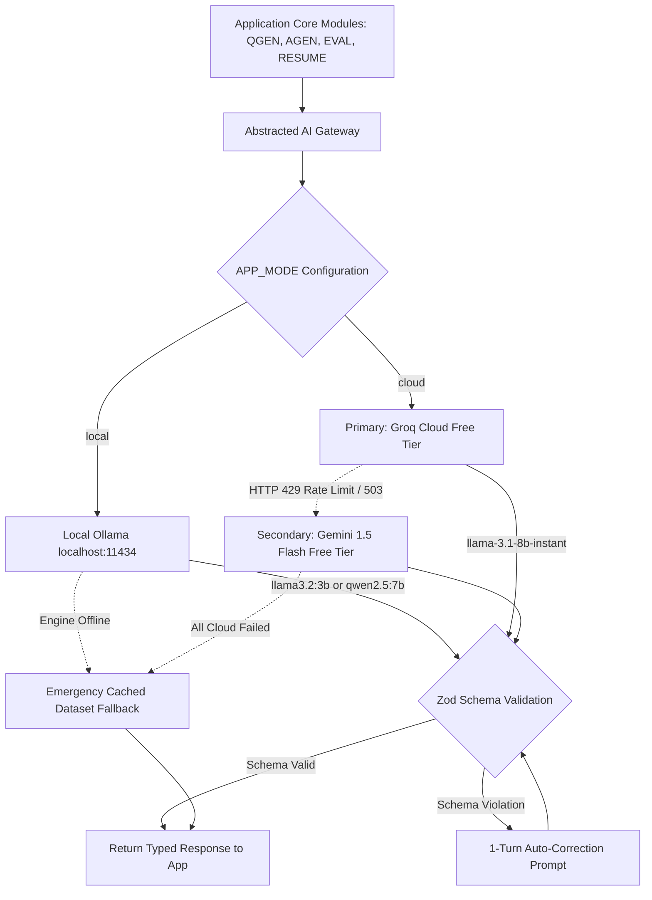

# TechQuery AI — AI Systems Architecture (Zero-Cost Gateway)

**Document ID:** TQ-DOC-006  
**Version:** 2.0.0 (Zero-Cost Rebuild)  
**Status:** Approved for Implementation  
**Author:** AI Systems Architect & Product Working Group  

---

## 1. Zero-Cost Architectural Philosophy

The AI subsystem must operate reliably at **strictly ₹0 cost**, without being held hostage by paid API tokens, credit card expirations, or external rate limit disruptions.

To achieve this, TechQuery AI establishes a **Dual-Engine AI Gateway**:
1. **Local Mode (`APP_MODE=local`):** Routes inference directly to **Ollama** running locally on `localhost:11434`. 100% free, offline, private, and unlimited. This serves as the primary engine for local development and placement demonstrations.
2. **Cloud Mode (`APP_MODE=cloud`):** Routes inference to the **Groq Cloud Free Tier** (`llama-3.1-8b-instant`) with automatic failover to **Google Gemini 1.5 Flash Free Tier**.
3. **Emergency Mock Fallback:** If all external providers are exhausted (or internet is cut off during a live demo), the gateway serves high-quality, pre-compiled domain datasets passing the exact same Zod schema.



---

## 2. Zero-Cost Model Selection Matrix

| Engine Mode | Workload / Task | Model Name | Host / Provider | Cost | Constraints / Performance |
| :--- | :--- | :--- | :--- | :--- | :--- |
| **Local Mode** | General Question & Answer Gen | `llama3.2:3b` | Local Ollama | **₹0.00** | Ultra-lightweight; runs smoothly on 4GB RAM CPU; < 2.0s latency |
| **Local Mode** | Deep Reasoning & Code Evaluation| `qwen2.5-coder:7b` / `llama3.1:8b` | Local Ollama | **₹0.00** | Requires 8GB–16GB RAM; outstanding technical accuracy |
| **Cloud Mode** | Primary Real-Time Generation | `llama-3.1-8b-instant` | Groq Free Tier | **₹0.00** | 30 RPM / 14,400 RPD free tier; ~300 tokens/sec |
| **Cloud Mode** | Cloud Backup & Rubric Eval | `gemini-1.5-flash` | Google Free Tier | **₹0.00** | 15 RPM / 1,500 RPD free tier without billing enabled |
| **Offline Mode**| System Failsafe Demonstration | Cached Canonical Graph | PostgreSQL Cache | **₹0.00** | 0ms latency; guaranteed 100% demo success rate |

---

## 3. Strict Structured Output Enforcement via Zod

Regardless of whether inference runs on local Ollama or cloud Groq, **unstructured text parsing is strictly forbidden**. Every model response must be validated against a strict Zod contract.

### 3.1 Defensive Parsing Pipeline
1. The gateway appends an explicit JSON schema contract to the system prompt.
2. The raw response string is cleaned of markdown fences (````json ... ````) and sanitized of unescaped control characters.
3. The parsed JSON object is validated against the task-specific Zod schema (e.g. `QuestionSetResponseSchema`, `ResumeExtractionSchema`, `EvaluationScorecardSchema`).
4. **Auto-Correction Loop:** If validation fails, the gateway issues a single low-temperature (0.0) repair turn quoting the specific Zod validation error path.
5. If the repair turn fails, the gateway switches to the secondary provider or cached fallback dataset.

---

## 4. Resilience & Graceful Degradation Protocols

### 4.1 Handling Groq Free Tier 429 Rate Limits
- Groq's free tier permits 30 requests per minute. Under burst usage (e.g., multiple people testing at once), HTTP 429 may occur.
- **Circuit Breaker Action:** When an HTTP 429 is encountered, the AI Gateway automatically trips for 60 seconds, transparently routing requests to Gemini 1.5 Flash Free or serving cached questions from PostgreSQL.

### 4.2 Handling Offline / No-Internet Placement Demo Scenarios
- College presentation halls frequently suffer from unstable Wi-Fi.
- In `APP_MODE=local`, TechQuery AI has **zero internet dependencies**. The Express backend connects to local Ollama (`localhost:11434`) and local PostgreSQL, ensuring uninterrupted demonstration of question generation, answer synthesis, and mock interview flow.

---

## 5. Token Efficiency & Context Window Management

Because free tiers restrict request counts and burst token rates, prompts are engineered for maximum token efficiency:
- **Resume Ingestion:** Strips boilerplate disclaimers and whitespace before prompt injection, capping input at 1,000 tokens.
- **Job Description Parsing:** Extracts only technical requirement sections, capping input at 800 tokens.
- **Output Token Caps:** Strict `max_tokens` enforced per call (`max_tokens: 1200` for 15 questions; `max_tokens: 400` for model answers).
