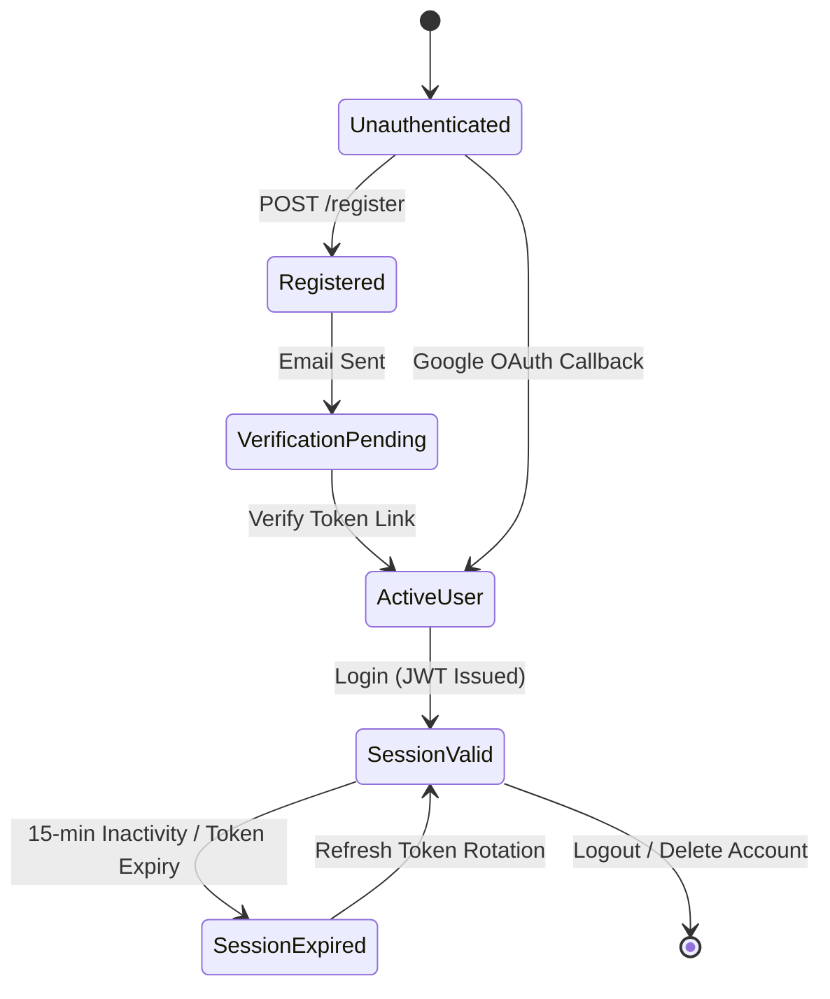
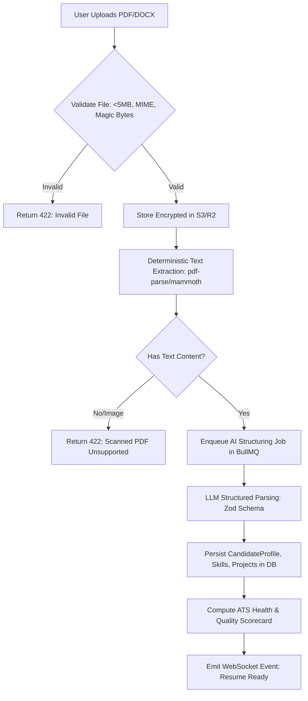
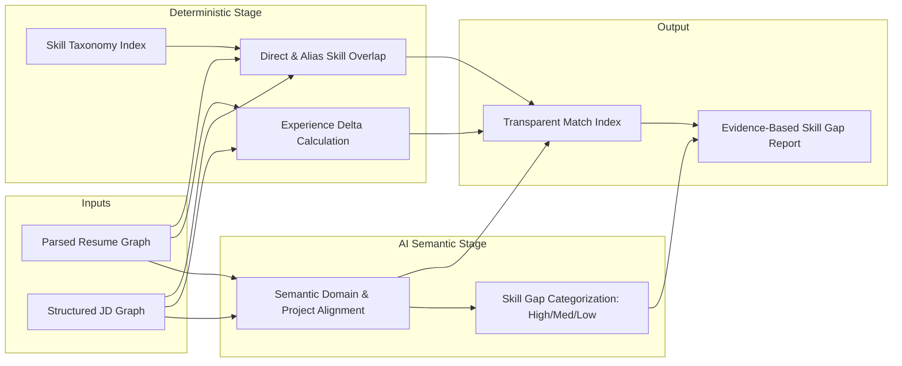
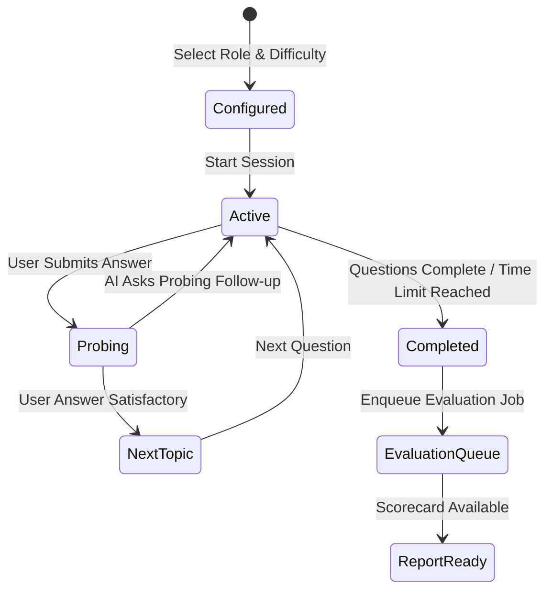
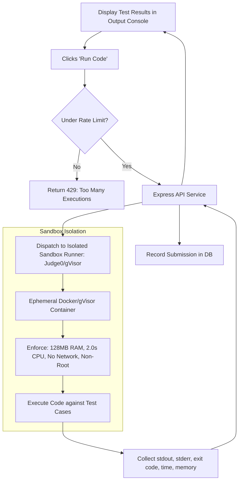

# TechQuery AI — Comprehensive Feature Specification

**Document ID:** TQ-DOC-003  
**Version:** 1.0.0 (Production Rebuild)  
**Status:** Approved for Product Discovery  
**Author:** Product & Architecture Working Group  

---

## Prioritization Framework
- **P0 (Critical):** Non-negotiable for initial production release (V1 MVP). The platform cannot function without these.
- **P1 (High):** Core differentiators required for market competitiveness and deep user retention (Targeted for V1/V2).
- **P2 (Medium):** Advanced capabilities providing delightful experiences and high-value simulation (V2/V3).
- **P3 (Future Enhancement):** Strategic long-term features requiring external infrastructure or monetization validation (V3+).

---

## Module 1: Authentication & Account Security (AUTH)

### Feature AUTH-001: Production-Grade Authentication & Session Management
- **Description:** Complete user identity management including local email/password authentication, Google OAuth 2.0, cryptographically secure password hashing, and token-based session management.
- **Problem It Solves:** Legacy system stored passwords without strict validation, used non-refreshing short-lived JWTs, lacked email verification, and had no OAuth support.
- **User Workflow:**
  1. User accesses `/register` or `/login`.
  2. Submits credentials or clicks "Continue with Google".
  3. Receives automated verification email (if registering locally).
  4. Accesses application with an HttpOnly `refreshToken` and an in-memory/short-lived `accessToken`.
- **Functional Requirements:**
  - Mandatory email verification before unlocking AI generation features.
  - Google OAuth 2.0 integration via official Google Identity Services.
  - Password strength validation: Minimum 8 characters, at least 1 uppercase letter, 1 number, and 1 special symbol.
  - Passwords hashed using `bcrypt` (work factor 12) or `argon2id`.
  - Secure session storage: Short-lived access token (15 mins), long-lived refresh token (7 days, stored in `HttpOnly`, `Secure`, `SameSite=Strict` cookie with automatic reuse detection).
  - Rate limiting on login and registration endpoints (max 5 failed attempts per IP/account per 15 minutes).
- **Inputs:** `email` (string), `password` (string), `name` (string), `google_token` (string, optional).
- **Outputs:** JWT payload (`userId`, `email`, `role`, `tier`), HttpOnly cookie with refresh token.
- **Business Rules:**
  - Accounts with unverified emails can view landing and public demo pages, but cannot trigger background AI jobs.
  - Refresh tokens are single-use; if a consumed token is re-presented, all sessions for that user are immediately invalidated (anti-theft rotation).
- **Error Scenarios:**
  - Duplicate email ➔ HTTP 409 Conflict with clear error.
  - Invalid password ➔ HTTP 401 Unauthorized with generic message ("Invalid credentials").
  - Rate limit exceeded ➔ HTTP 429 Too Many Requests with retry-after header.
- **Dependencies:** PostgreSQL, Redis (for token blacklisting & rate limiting), Resend API.
- **Acceptance Criteria:**
  - Automated test suite achieves 100% pass rate on OWASP auth test scenarios.
  - Token refresh works seamlessly in background without logging out active users.
- **Priority:** **P0**

---

## Module 2: User Onboarding & Profiling (ONBD)

### Feature ONBD-001: Progressive User Profiling Wizard
- **Description:** Multi-step onboarding experience capturing academic background, target roles, current technical skill self-assessment, and interview timelines.
- **Problem It Solves:** Legacy system forced users to manually re-type their profile context on every generation screen.
- **User Workflow:**
  1. Post-registration, user is routed to `/onboarding`.
  2. Selects Target Role (e.g., SDE-1 Backend, Frontend, Full Stack, Data Engineer).
  3. Selects Experience Level (Student, Fresher, 1–3 years, 3–5 years, 5+ years).
  4. Selects Primary Languages & Frameworks.
  5. Selects Target Company Tier (Service-based, Mid-sized Product, FAANG/Tier-1).
  6. Submits and arrives at personalized dashboard.
- **Functional Requirements:**
  - Multi-step stateful wizard with draft auto-saving.
  - Standardized skill taxonomy matching (prevents spelling duplicates like "ReactJS" vs "React.js").
  - Target role pre-sets that seed the recommendation engine.
- **Inputs:** `education_level`, `experience_years`, `target_role`, `target_companies[]`, `skills[]`.
- **Outputs:** Persisted `UserProfile` record, initial dashboard configuration.
- **Business Rules:**
  - Users can update their profile at any time in `/settings/profile`.
- **Error Scenarios:**
  - Missing required fields ➔ Inline form validation highlighting incomplete steps.
- **Dependencies:** AUTH-001, PostgreSQL.
- **Acceptance Criteria:**
  - Completing onboarding populates default question recommendations on dashboard within 200ms.
- **Priority:** **P0**

---

## Module 3: Resume Intelligence Engine (RES)

### Feature RES-001: Multi-Format Resume Parser & Extraction Engine
- **Description:** Ingests PDF and DOCX resume files, performs server-side text extraction, sanitizes input, and invokes the AI Gateway to construct a normalized candidate data graph.
- **Problem It Solves:** The old system required users to manually copy-paste raw text into an unformatted textarea, losing formatting, project structures, and bullet hierarchies.
- **User Workflow:**
  1. User drags and drops PDF/DOCX on `/resumes`.
  2. Client validates file size and extension.
  3. Backend extracts raw text, saves file (local disk in Mode A; Supabase Storage Free Tier or PostgreSQL DB Bytea in Mode B), and triggers async parsing.
  4. User views parsed sections: Contact Info, Education, Experience, Projects, Skills, and Certifications.
- **Functional Requirements:**
  - File size restricted to 5MB.
  - Magic byte verification preventing executable disguise (.exe renamed to .pdf).
  - Text extraction pipeline via open-source `pdf-parse` (for PDF) and `mammoth` (for DOCX).
  - AI extraction enforcing Zod schema: Skills, Work Experience (Company, Role, Duration, Bullet points), Projects (Title, Tech Stack, Description, Links), Education.
  - Scanned PDF detection: If extracted character count < 100 on a multi-page document, flag as image/scanned with actionable guidance to upload text-based export.
- **Inputs:** Multipart form data (`file`), `userId`.
- **Outputs:** `Resume` record, normalized JSON graph, parsed `CandidateSkill` rows.
- **Business Rules:**
  - Maximum 3 active resumes stored per free user; 10 per Pro user.
  - Files are encrypted at rest using AES-256 (or stored as byte buffers in PostgreSQL in cloud mode).
- **Error Scenarios:**
  - Corrupted PDF ➔ HTTP 422 with message: *"File appears corrupted or password-protected."*
  - Scanned PDF ➔ HTTP 422 with message: *"Scanned image PDFs are not supported. Please upload a native text PDF."*
- **Dependencies:** Local Disk Storage (Mode A) or Supabase Free Storage / DB Bytea (Mode B), AI Gateway.
- **Acceptance Criteria:**
  - Benchmark of 50 sample standard resumes parses with > 90% accuracy on skill and project extraction.
- **Priority:** **P0**

---

### Feature RES-002: ATS Quality Audit & Actionable Resume Improvement
- **Description:** Analyzes extracted resume text against recruitment industry benchmarks to calculate an ATS Readiness Score and provide concrete line-by-line enhancements.
- **Problem It Solves:** Candidates submit weak resumes filled with passive voice, missing contact info, unquantified achievements, and unindexed skills.
- **User Workflow:**
  1. From parsed resume view, user clicks *"View ATS Quality Audit"*.
  2. Inspects overall score (0–100) and categorized breakdown: Formatting, Content & Impact, Action Verbs, Quantification.
  3. Clicks on highlighted weak bullet points to view AI-suggested rewrites using the Google X-Y-Z formula: *"Accomplished [X], as measured by [Y], by doing [Z]"*.
- **Functional Requirements:**
  - Deterministic checks: Missing email/phone/GitHub links, total word count, section header detection.
  - AI qualitative checks: Passive vs active verb ratio, metric density (presence of %, numbers, dollar values).
  - Concrete rewrite suggestions for each weak bullet point.
- **Inputs:** Parsed resume JSON graph.
- **Outputs:** `ResumeAnalysis` record, ATS health score, list of actionable critique cards.
- **Business Rules:**
  - Scores must be accompanied by explicit reasons; arbitrary numerical ratings without evidence are prohibited.
- **Dependencies:** RES-001, AI Gateway.
- **Acceptance Criteria:**
  - Audit generates within 4 seconds of resume parsing completion.
- **Priority:** **P1**

---

## Module 4: Job Description Intelligence (JD)

### Feature JD-001: Semantic Job Description Parser & Decomposition
- **Description:** Deconstructs raw job descriptions into structured requirements, categorizing mandatory vs preferred skills, seniority expectations, and domain context.
- **Problem It Solves:** Candidates struggle to determine what a job posting actually requires versus generic corporate boilerplates.
- **User Workflow:**
  1. User pastes job description text or enters URL (text pasted in V1).
  2. Backend extracts core attributes and persists a clean `JobDescription` record.
  3. User views structured breakdown: Role Title, Seniority, Must-Have Skills, Good-to-Have Skills, Core Responsibilities.
- **Functional Requirements:**
  - Input sanitization (strips malicious script tags or prompt injection attempts).
  - AI extraction enforcing structured Zod schema.
  - Normalization of skill names to canonical taxonomy (e.g., "PostgreSQL" ➔ "postgres").
- **Inputs:** `raw_text` (string, 150–10,000 characters), `job_title` (optional), `company_name` (optional).
- **Outputs:** `JobDescription` record with structured JSON attributes.
- **Business Rules:**
  - Free users can store up to 5 JDs; Pro users up to 50.
- **Error Scenarios:**
  - Input < 150 characters ➔ HTTP 400 Bad Request.
- **Dependencies:** AI Gateway, PostgreSQL.
- **Acceptance Criteria:**
  - Accurately separates "Required" from "Preferred" qualifications across standard job post formats.
- **Priority:** **P0**

---

## Module 5: Resume-JD Matching Engine (MATCH)

### Feature MATCH-001: Evidence-Based Match Scoring & Skill-Gap Reporting
- **Description:** Evaluates a candidate's resume against a target JD using a transparent hybrid approach (deterministic keyword matching + AI semantic reasoning) to generate an actionable gap report.
- **Problem It Solves:** Prevents misleading, hallucinated "black-box" matching scores by clearly showing *why* a candidate matches or falls short.
- **User Workflow:**
  1. User selects Resume A and Job Description B on `/match`.
  2. System computes and displays Match Summary.
  3. User reviews Matched Competencies, Critical Missing Skills, and Project Relevancy scores.
  4. System recommends high-priority preparation actions to bridge the gap before interviewing.
- **Functional Requirements:**
  - Hybrid scoring formula: 50% Deterministic Skill Overlap + 30% Project/Domain Relevance + 20% Experience Level Alignment.
  - Clear categorization of missing skills: Critical (Must-have in JD), Secondary (Nice-to-have), Absent in Resume but potentially known.
  - Mandatory Disclaimer Banner: *"Match scores represent automated keyword and semantic alignment for preparation guidance. They do not simulate internal corporate recruiter applicant filters."*
- **Inputs:** `resume_id`, `jd_id`.
- **Outputs:** `JobMatch` record, Match Score (0–100%), detailed breakdown JSON.
- **Business Rules:**
  - If resume has 0 matching skills, match score is capped at 15% maximum.
- **Dependencies:** RES-001, JD-001, AI Gateway.
- **Acceptance Criteria:**
  - Full match report renders in < 3 seconds when structured graphs are already cached in DB.
- **Priority:** **P0**

---

## Module 6: AI Question Generation Engine (QGEN)

### Feature QGEN-001: Context-Aware Interview Question Synthesis
- **Description:** Generates tailored technical, algorithmic, system design, and behavioral questions derived directly from the candidate's resume projects and target JD requirements.
- **Problem It Solves:** Replaces the legacy system's unformatted, generic text lists with categorized, difficulty-calibrated questions that interviewers actually ask.
- **User Workflow:**
  1. User configures generation parameters on `/generate`:
     - Selects Resume & JD context (or chooses standalone skill/topic).
     - Selects Question Count (10, 15, 20).
     - Selects Question Distribution (e.g., 40% Theory, 40% Coding, 20% System Design).
     - Selects Interviewer Persona (Friendly Peer, Rigorous Bar-Raiser, Startup Founder).
  2. Clicks *"Generate Questions"*.
  3. Progress bar tracks asynchronous generation.
  4. Questions load into categorized interactive cards.
- **Functional Requirements:**
  - Strict structured JSON response enforced via Zod schema (`QGEN_Schema`):
    - `id`: unique UUID.
    - `question_text`: string.
    - `category`: `THEORETICAL | CODING | SYSTEM_DESIGN | BEHAVIORAL | PROJECT_DEFENSE`.
    - `difficulty`: `EASY | MEDIUM | HARD`.
    - `targeted_skill`: string.
    - `interviewer_intent`: string (explaining what the interviewer is evaluating).
    - `key_evaluation_points`: array of strings (concepts required in a solid answer).
  - Project defense questions directly reference projects listed in the candidate's resume (e.g., *"In your E-Commerce project, why did you choose Redis over Memcached for session management?"*).
- **Inputs:** `resume_id` (optional), `jd_id` (optional), `topic` (optional), `difficulty`, `count`, `distribution`.
- **Outputs:** `QuestionSet` record containing related `Question` entities.
- **Business Rules:**
  - Minimum 10 questions, maximum 20 per generation request.
  - Free users: 5 generations/month; Pro users: 50 generations/month.
- **Error Scenarios:**
  - AI API failure ➔ Automated retry with fallback provider (Groq ➔ Gemini ➔ OpenAI).
  - Rate limit reached ➔ Prompt upgrade modal.
- **Dependencies:** AI Gateway, PostgreSQL, BullMQ.
- **Acceptance Criteria:**
  - 100% of generated questions pass schema validation before persisting to DB.
- **Priority:** **P0**

---

## Module 7: AI Answer Generation Engine (AGEN)

### Feature AGEN-001: Multi-Tiered Model Answers & Deep Explanations
- **Description:** Produces structured, accurate model answers for any generated or saved question, including quick summaries, technical deep dives, complexity analysis, and common candidate pitfalls.
- **Problem It Solves:** In the legacy app, answers were never saved to the database and relied on brittle single-line JSON parsing that regularly crashed.
- **User Workflow:**
  1. User clicks *"Reveal Model Answer"* on any question card.
  2. If answer was previously generated, loads immediately from DB.
  3. If new, generates via AI Gateway and displays with rich markdown formatting.
- **Functional Requirements:**
  - Structured output schema:
    - `short_summary`: 2–3 sentence executive elevator pitch answer.
    - `detailed_explanation`: Comprehensive technical explanation.
    - `code_snippet`: Optional syntax-highlighted code implementation.
    - `time_complexity`: string (e.g., "O(N log N)").
    - `space_complexity`: string (e.g., "O(1)").
    - `common_mistakes`: List of misconceptions or anti-patterns to avoid.
  - Answers are persisted permanently in the `answers` table linked to `question_id`.
- **Inputs:** `question_id`, `difficulty_context`.
- **Outputs:** `Answer` record linked to `Question`.
- **Business Rules:**
  - Coding answers must adhere to production best practices (modular code, meaningful variable names, edge-case checks).
- **Dependencies:** QGEN-001, AI Gateway, PostgreSQL.
- **Acceptance Criteria:**
  - Cached answers return in < 50ms; new generations return in < 3.5s via Groq/Llama-3.1-8B.
- **Priority:** **P0**

---

## Module 8: AI Mock Interview Engine (MOCK)

### Feature MOCK-001: Interactive Conversational Mock Interview Simulator
- **Description:** A simulated real-time interview environment where an AI Interviewer conducts technical or behavioral rounds, asking dynamic follow-up questions based on the candidate's responses.
- **Problem It Solves:** Static question reading does not prepare candidates for the conversational pressure and follow-up probes of live interviews.
- **User Workflow:**
  1. User visits `/interviews/new`, selects format (Technical, System Design, HR), duration (15 or 30 mins), and clicks *"Start Interview"*.
  2. Enters full-screen interview room.
  3. AI Interviewer greets candidate and asks Question 1.
  4. Candidate types or dictates answer and clicks *"Submit"*.
  5. AI analyzes answer:
     - If incomplete or vague, asks an adaptive follow-up probe (max 2 probes per question).
     - If thorough, validates and moves to next core question.
  6. At end of session, system closes session and triggers evaluation pipeline.
- **Functional Requirements:**
  - Session state managed via Redis with 60-minute TTL to survive accidental tab closures.
  - Support for text-based conversational chat; architectural hooks for Web Speech API (speech-to-text) in V2.
  - Adaptive follow-up logic: AI maintains conversation memory of previous 5 turns within token budget.
- **Inputs:** `interview_type`, `target_role`, `duration_minutes`, `user_responses[]`.
- **Outputs:** `MockInterview` record, transcript log, `InterviewQuestion` records.
- **Business Rules:**
  - Free tier: 1 mock interview session per month; Pro tier: 10 sessions per month.
- **Dependencies:** AI Gateway, Redis, PostgreSQL.
- **Acceptance Criteria:**
  - AI interviewer responds within 2.0 seconds per conversational turn.
- **Priority:** **P1**

---

## Module 9: AI Answer Evaluation Engine (EVAL)

### Feature EVAL-001: Multi-Dimensional Objective Evaluation Rubrics
- **Description:** Evaluates candidate interview responses against an industry-standard rubric to produce an actionable scorecard with specific feedback and remediation suggestions.
- **Problem It Solves:** Replaces sycophantic, generic LLM praise ("Great job!") with rigorous, constructive feedback that reflects actual engineering hiring bars.
- **User Workflow:**
  1. After completing a mock interview, user views `/interviews/:id/report`.
  2. Inspects Overall Hiring Recommendation: `Strong Hire | Hire | Leaning Hire | Leaning No Hire | No Hire`.
  3. Reviews scorecards across 4 core dimensions (1–10 scale):
     - Technical Correctness & Accuracy.
     - Depth & Practical Understanding.
     - Problem-Solving & Edge-Case Awareness.
     - Communication Clarity & Structure.
  4. Reads detailed critique on specific transcript excerpts.
- **Functional Requirements:**
  - Rubric-grounded evaluation prompt: AI must cite specific phrases from the candidate's answer to justify score deductions.
  - Identification of missing keywords and concepts.
  - Presentation of an "Ideal Model Answer" for every question where candidate scored < 7/10.
- **Inputs:** Full interview transcript (`InterviewQuestion` and `InterviewResponse` records).
- **Outputs:** `InterviewEvaluation` record with dimensional scores, strengths, weaknesses, and improvement plan.
- **Business Rules:**
  - Mandatory Disclaimer: *"This evaluation is an automated AI simulation for preparation purposes. Actual hiring decisions vary across organizations."*
- **Dependencies:** MOCK-001, AI Gateway.
- **Acceptance Criteria:**
  - Evaluation scorecard generates within 8 seconds of interview completion.
- **Priority:** **P1**

---

## Module 10: Coding Interview Practice & Sandboxing (CODE)

### Feature CODE-001: In-Browser Client-Side Algorithmic Practice Environment
- **Description:** Integrated coding practice environment featuring the Monaco Editor, client-side Python execution via Pyodide (WebAssembly), JavaScript execution in an isolated Web Worker, and language-specific curated algorithmic exercises for Java and C++.
- **Problem It Solves:** Prepares candidates for algorithmic coding rounds with zero server infrastructure expenses and zero server-side remote code execution (RCE) risk.
- **User Workflow:**
  1. User selects a coding problem on `/practice/coding/:id`.
  2. Reads Problem Description, Input/Output formats, Constraints, and Examples.
  3. Writes solution in Monaco Editor.
  4. For Python or JavaScript, clicks *"Run Code"* to test against visible sample test cases directly in the browser; clicks *"Submit Solution"* to run against hidden test cases.
  5. For Java and C++, reviews problem constraints, edits code with full syntax highlighting, and requests AI Complexity & Correctness Review.
  6. Console displays real-time execution outputs and pass/fail metrics.
- **Functional Requirements:**
  - Client-side execution sandbox:
    - **Python:** Executed client-side via **Pyodide (WebAssembly)** running inside an isolated Web Worker with memory and execution timeout guards (2.0s).
    - **JavaScript:** Executed client-side inside an isolated Web Worker with disabled DOM access.
    - **Java & C++:** Full Monaco syntax editing, curated test cases, and AI Model Solutions. (Live compiler execution deferred to local Docker runner or V3).
  - Progressive AI Hints: 3 levels of hints available on demand without spoiling the solution.
- **Inputs:** `problem_id`, `language`, `code_string`.
- **Outputs:** `CodingSubmission` record, client-side execution metrics (runtime in ms), test case diffs.
- **Business Rules:**
  - Runs 100% on client CPU; 0MB server RAM consumed.
- **Error Scenarios:**
  - Infinite loops / Timeout ➔ Web Worker terminated at 2.0s; returns Time Limit Exceeded.
  - Python Syntax/Runtime Error ➔ Pyodide error output captured and formatted in console.
- **Dependencies:** Monaco Editor, Pyodide (WebAssembly), Web Worker runtime.
- **Acceptance Criteria:**
  - Python code runs and returns test case pass/fail indicators in < 400ms without sending code to backend API.
- **Priority:** **P2** (V3)

---

## Module 11: Career Intelligence & Learning Roadmaps (CAREER)

### Feature CAREER-001: Adaptive Career Readiness & Skill Roadmap Generator
- **Description:** Generates structured, milestone-driven preparation roadmaps that guide candidates through targeted learning sprints based on diagnosed skill gaps.
- **Problem It Solves:** Candidates feel lost after discovering their skill gaps; they need a sequential, prioritized study plan.
- **User Workflow:**
  1. User visits `/career/roadmap`.
  2. Selects target milestone (e.g., "Ready for SDE-1 Backend in 60 Days").
  3. System analyzes user's verified skills and recent mock interview gaps.
  4. Generates weekly roadmap containing curated documentation, specific coding problems, and verification checkpoints.
- **Functional Requirements:**
  - Dynamic milestone tree with interactive progress checkboxes.
  - Direct deep links from roadmap milestones to internal Question Bank topics and Coding Challenges.
- **Inputs:** `UserProfile`, `ResumeAnalysis`, `JobMatch`.
- **Outputs:** `PreparationPlan` record with milestone hierarchy.
- **Business Rules:**
  - Roadmaps dynamically update when user passes relevant coding problems or mock interview topics.
- **Dependencies:** MATCH-001, EVAL-001, PostgreSQL.
- **Acceptance Criteria:**
  - Roadmap generation returns complete structured sprints in < 4.0 seconds.
- **Priority:** **P1**

---

## Module 12: Preparation Dashboard & Analytics (DASH)

### Feature DASH-001: Data-Driven Preparation Command Center
- **Description:** Unified analytics dashboard aggregating actual user preparation metrics, activity streaks, topic masteries, and readiness scores.
- **Problem It Solves:** Replaces fake/static dashboard numbers with real, evidence-backed progress metrics computed directly from user activities.
- **User Workflow:**
  1. User logs in and lands on `/dashboard`.
  2. Inspects key performance indicators (KPIs):
     - Total Questions Mastered.
     - Mock Interviews Completed & Average Readiness Score.
     - Coding Problems Solved (Easy / Medium / Hard).
     - Active Day Streak.
  3. Reviews "Top Weak Areas" widget with direct 1-click practice shortcuts.
- **Functional Requirements:**
  - All metrics computed via indexed relational queries in PostgreSQL (no fabricated or mock stats).
  - Visual activity calendar (GitHub-style contribution squares) tracking daily prep sessions.
- **Inputs:** `userId`.
- **Outputs:** Consolidated dashboard metrics JSON.
- **Dependencies:** AUTH-001, QGEN-001, MOCK-001, CODE-001.
- **Acceptance Criteria:**
  - Dashboard API response resolves in < 150ms using aggregated materialized views or indexed counts.
- **Priority:** **P0**

---

## Module 13: Question Bank & Learning Library (LIB)

### Feature LIB-001: Question Collections, Tagging, & PDF Export
- **Description:** Personal question management system allowing users to organize saved questions into custom collections, add personal study notes, and export professional study sheets to PDF.
- **Problem It Solves:** Candidates need an organized way to bookmark difficult questions for last-minute revision before heading into an interview.
- **User Workflow:**
  1. User navigates to `/library`.
  2. Filters questions by Topic, Tag, Difficulty, or Company.
  3. Organizes questions into custom folders (e.g., "Amazon Final Round Revision").
  4. Clicks *"Export PDF"* to generate a clean, branded preparation guide.
- **Functional Requirements:**
  - Full-text search across question texts and model answers.
  - Client-side or server-side high-fidelity PDF generation (`jsPDF` / `@react-pdf/renderer`) supporting multi-page formatting, page numbers, and syntax-highlighted code.
- **Inputs:** `collection_id`, filter parameters.
- **Outputs:** Filtered question sets, generated PDF binary stream.
- **Business Rules:**
  - Exported PDFs include candidate name, target role, and generated date watermark.
- **Dependencies:** QGEN-001, AGEN-001, PostgreSQL.
- **Acceptance Criteria:**
  - PDF export of 25 questions with code snippets compiles and downloads in < 2 seconds.
- **Priority:** **P0**

---

## Module 14: Notifications & Reminders (NOTIF)

### Feature NOTIF-001: Multi-Channel Preparation Notifications
- **Description:** Transactional email and in-app notification engine delivering account security alerts, background job completions, and study reminders.
- **Problem It Solves:** Informs users when long-running AI jobs complete and nudges inactive candidates to maintain preparation streaks.
- **User Workflow:**
  1. User triggers heavy resume analysis or mock interview evaluation.
  2. Can navigate away from page; receives in-app toast and notification badge when ready.
  3. Receives weekly preparation summary via email.
- **Functional Requirements:**
  - In-app notification center with read/unread state.
  - Transactional emails via Resend API: Email verification, password reset, interview evaluation ready.
  - User notification preference toggles in `/settings/notifications`.
- **Inputs:** `event_type`, `user_id`, `payload`.
- **Outputs:** Email delivery, `Notification` record in DB.
- **Dependencies:** Resend API, BullMQ, PostgreSQL.
- **Acceptance Criteria:**
  - Transactional emails arrive within 10 seconds of trigger event.
- **Priority:** **P1**

---

## Module 15: SaaS Subscription, Quota & Usage Management (BILL)

### Feature BILL-001: Multi-Tier Quota Tracking & Subscription Management
- **Description:** Enforces tier-based usage limits across AI generations, mock interviews, and code runs; manages subscription state and early-access limits.
- **Problem It Solves:** Prevents runaway LLM API consumption and prepares the product architecture for seamless payment integration.
- **User Workflow:**
  1. User views remaining credits in header badge or `/settings/billing`.
  2. When usage reaches 100%, action is blocked with upgrade modal.
  3. (V2/V3) User clicks "Upgrade to Pro", completes checkout, and quota unlocks immediately.
- **Functional Requirements:**
  - Atomic quota checking and decrementing using Redis counters backed by PostgreSQL `usage_records`.
  - Quotas tracked per 30-day billing cycle:
    - `resume_parses_count`
    - `question_generations_count`
    - `mock_interviews_count`
    - `code_executions_count`
  - V1 implements Free Tier with promotional bonus credits; V2/V3 integrates Razorpay / Stripe webhooks.
- **Inputs:** `userId`, `action_type`.
- **Outputs:** Quota validation boolean (`allowed: true/false`), updated usage record.
- **Business Rules:**
  - Free Tier limits: 3 Resumes, 5 Question Sets/mo, 1 Mock Interview/mo, 50 Code Runs/day.
  - Pro Tier limits: 10 Resumes, 50 Question Sets/mo, 10 Mock Interviews/mo, Unlimited Code Runs.
- **Dependencies:** Redis, PostgreSQL.
- **Acceptance Criteria:**
  - Reaching quota limit prevents LLM execution instantly with zero overages.
- **Priority:** **P0** (Quota enforcement); **P2** (Payment processing).
