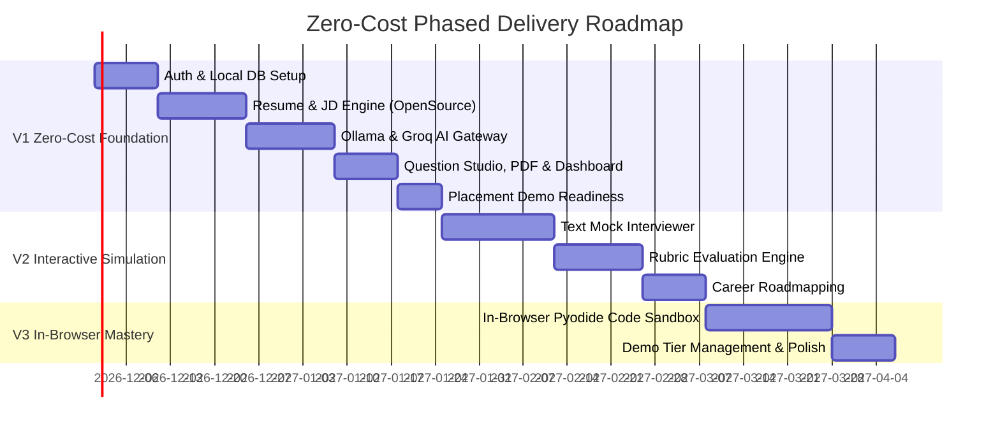

# TechQuery AI — Multi-Phase Release Roadmap (Zero-Cost Scope)

**Document ID:** TQ-DOC-008  
**Version:** 2.0.0 (Zero-Cost Rebuild)  
**Status:** Approved for Implementation Planning  
**Author:** Product & Architecture Working Group  

---

## 1. Phased Delivery Overview (Zero-Cost Calibrated)

To align with academic placement deadlines, minimize external cloud dependencies, and guarantee ₹0 operational costs, TechQuery AI is structured into three realistic releases:

---

## 2. Release V1: Core AI Career & Interview Preparation SaaS (The Foundation)

### 2.1 Release Objective
Deliver a production-grade, highly reliable, and delightful interview preparation studio operating seamlessly in both **Local Mode (Ollama + local Postgres)** and **Cloud Mode (Groq Free Tier + Neon + Render)** at ₹0 cost.

### 2.2 Feature Scope
- **`AUTH-001` & `AUTH-002`:** Production authentication, bcrypt hashing, HttpOnly refresh token rotation, Google OAuth, email verification (Resend Free / Console bypass).
- **`ONBD-001`:** Progressive multi-step onboarding wizard.
- **`RES-001` & `RES-002`:** Native PDF/DOCX file upload, open-source text extraction (`pdf-parse`, `mammoth`), structured Zod entity parsing, and ATS health score.
- **`JD-001`:** Structured job description decomposition into mandatory vs nice-to-have skills.
- **`MATCH-001`:** Deterministic + semantic hybrid matching with transparent gap report.
- **`QGEN-001`:** Context-aware question synthesis with difficulty, distribution, and interviewer intent tags (powered by Groq Llama-3.1-8B or Local Ollama).
- **`AGEN-001`:** Multi-tiered model answers with time/space complexity analysis and permanent PostgreSQL persistence.
- **`LIB-001`:** Saved question collections, tagging, full-text search, and formatted PDF export via `jsPDF`.
- **`DASH-001`:** Data-driven preparation dashboard (streak tracking, question completion counts).
- **`BILL-001`:** Internal quota tracking (Free vs Pro Demo tiers) with simulated upgrade toggle.

### 2.3 Definition of Done (DoD) for V1
1. System runs 100% locally with `APP_MODE=local` using Ollama and local PostgreSQL with zero internet access.
2. System deploys successfully to Vercel (frontend) and Render (backend) with zero paid subscriptions.
3. 100% of P0 functional requirements verified by automated Vitest / Playwright tests.
4. P95 latency for question set generation < 3.5s via Groq Free Tier and < 2.5s via local Ollama.
5. All uploaded resumes pass magic byte validation and are securely stored with zero data loss.

---

## 3. Release V2: Intelligent Interview Simulator & Career Roadmapping

### 3.1 Release Objective
Introduce dynamic conversational interview simulations and multi-factor rubric evaluations operating strictly within free compute boundaries.

### 3.2 Feature Scope
- **`MOCK-001`:** Interactive text-based conversational mock interview engine with Redis / in-memory state persistence.
- **`MOCK-002`:** Dynamic follow-up probing: AI analyzes previous responses and asks clarifying follow-ups before changing topics.
- **`EVAL-001`:** Multi-dimensional objective evaluation rubric (Correctness, Depth, Communication, Problem-Solving) with evidence quotes.
- **`CAREER-001`:** Adaptive career readiness analysis and milestone-driven preparation roadmaps.
- **`NOTIF-001`:** In-app notification center and automated email reminders (Resend Free).

### 3.3 Definition of Done (DoD) for V2
1. Mock interview state survives accidental browser refresh with zero loss of transcript.
2. AI evaluation scorecard generates within 8 seconds citing exact user transcript quotes.
3. Fits entirely within Render free tier (512MB RAM) without memory leaks.

---

## 4. Release V3: In-Browser Algorithmic Mastery & Showcase Polish

### 4.1 Release Objective
Add sandboxed coding practice powered client-side via WebAssembly and polish the entire platform for placement demonstrations.

### 4.2 Feature Scope
- **`CODE-001`:** Integrated Monaco code editor with in-browser Python execution powered by **Pyodide (WebAssembly)** running in a Web Worker (100% free, zero server load).
- **`CODE-002`:** Automated algorithmic complexity analysis and progressive AI hint assistant.
- **`MOCK-003`:** Voice-enabled simulation powered by the browser-native **Web Speech API** (100% free, runs client-side).
- **`BILL-002`:** Interactive "SaaS Subscription Demo" allowing placement evaluators to toggle between Free and Pro features dynamically.

---

## 5. Explicitly Out-of-Scope Features (Zero-Cost Anti-Scope)

To prevent timeline slippage, infrastructure expenses, and security vulnerabilities:
1. ❌ **Commercial Payment Gateway Integration:** No Razorpay / Stripe dependencies.
2. ❌ **Server-Side Untrusted Code Execution:** No paid Judge0 or server-side Docker runners. All code runs client-side in WebAssembly.
3. ❌ **Paid Voice / Audio APIs:** No ElevenLabs or commercial neural TTS; native browser Web Speech API is used.
4. ❌ **Paid Cloud Domains / SSL:** Free subdomains (`*.vercel.app`, `*.onrender.com`) are used exclusively.
