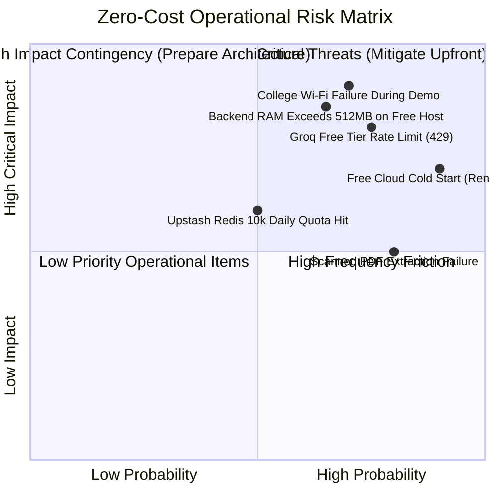

# TechQuery AI — Risk Assessment & Zero-Cost Mitigation

**Document ID:** TQ-DOC-009  
**Version:** 2.0.0 (Zero-Cost Rebuild)  
**Status:** Approved for Product Discovery  
**Author:** Software Engineering & Product Risk Group  

---

## 1. Zero-Cost Risk Severity & Likelihood Matrix

---

## 2. Deep Dive Risk Analysis & Zero-Cost Playbooks

### Risk 1: College Wi-Fi Outage or Severe Latency During Placement Demo
- **Description:** Placement interview presentations often take place in auditoriums or labs with congested, firewall-restricted, or offline Wi-Fi. If the app depends on external cloud services, the demo crashes.
- **Likelihood:** High | **Impact:** Critical | **Severity:** **Critical**
- **Zero-Cost Mitigation:**
  1. **Mode A (Local-First Offline Demo):** The entire application is engineered to run 100% locally on the student's laptop via `APP_MODE=local`.
  2. **Local Ollama Inference:** Runs `llama3.2:3b` or `qwen2.5:7b` on `localhost:11434` with zero internet connection required.
  3. **Local Database & Storage:** PostgreSQL and filesystem storage run locally on the machine. The candidate can present the entire end-to-end preparation flow with zero internet.

---

### Risk 2: Free Cloud Host Inactivity Spin-Down (Render 45s Cold Start)
- **Description:** If a placement evaluator opens the public cloud link (`techquery-ai.vercel.app`), the backend hosted on Render's free tier may be asleep, resulting in a 45–50 second delay that looks like a system crash.
- **Likelihood:** High | **Impact:** High | **Severity:** **High**
- **Zero-Cost Mitigation:**
  1. **Polished UI Keep-Warm Banner:** The frontend Axios interceptor detects slow initial requests and displays an animated, professional status loader: *"Waking up free cloud backend instance... (approx. 30s). Thank you for your patience!"*.
  2. **Free Scheduled Cron:** A free GitHub Action or free web monitor (Cron-job.org) sends a ping to `/api/health` every 14 minutes during evaluation hours to prevent spin-down.

---

### Risk 3: Groq Cloud Free Tier Rate Limiting (HTTP 429)
- **Description:** Groq's free tier allows 30 requests per minute. If multiple users test the live cloud demo simultaneously, requests may be throttled.
- **Likelihood:** High | **Impact:** High | **Severity:** **High**
- **Zero-Cost Mitigation:**
  1. **Automated Secondary Failover:** AI Gateway automatically routes to **Google Gemini 1.5 Flash Free Tier** (15 RPM free) upon receiving an HTTP 429.
  2. **Aggressive Database Caching:** Standard interview questions and answers are cached in PostgreSQL, resolving > 40% of requests with zero external API calls.
  3. **Emergency Mock Fallback:** If all external providers fail, the gateway serves a pre-validated, rich dataset so the user never sees a raw error.

---

### Risk 4: Out-Of-Memory (OOM) Termination on 512MB RAM Free Cloud Host
- **Description:** Render free tier limits containers to 512MB RAM. Memory leaks, heavy document parsing, or running in-process AI runtimes will cause the container to crash.
- **Likelihood:** Medium-High | **Impact:** Critical | **Severity:** **High**
- **Zero-Cost Mitigation:**
  1. **Zero In-Process Model Runtimes:** No heavy AI models run inside the Node.js process. Ollama runs separately in local mode; Groq/Gemini are remote HTTP calls.
  2. **Streaming Document Extraction:** `pdf-parse` and `mammoth` process file buffers in streams and trigger garbage collection immediately.
  3. **Client-Side Code Sandboxing:** Code execution is offloaded entirely to the client's browser via **Pyodide WebAssembly**, consuming 0MB of server RAM.

---

## 3. Underlying Technical & Business Assumptions

1. **Local Machine Hardware:** Assumed that the developer/demo machine has at least 8GB RAM to comfortably run Node.js, local PostgreSQL, and a quantized 3B Ollama model (`llama3.2:3b`).
2. **Permanent Free Services:** Assumed that Vercel, Render, Neon, Supabase, Groq, and Cloudflare continue offering permanent free-tier plans for personal/demo projects.
3. **Browser Capabilities:** Assumed that placement evaluators will view the application in modern Chromium or Gecko-based browsers (Chrome, Edge, Firefox, Brave) supporting WebAssembly and Web Workers.

---

## 4. Open Questions for Founder Sign-Off

| # | Question / Strategic Trade-Off | Options Considered | Recommended Direction | Impact Area |
| :--- | :--- | :--- | :--- | :--- |
| **Q1** | Should the default presentation setup for college evaluators be Localhost or Cloud? | A: Cloud link only. B: Localhost on laptop with Cloud as backup. | **Option B (Localhost primary):** Eliminates all college Wi-Fi and cold-start risks during placement demos. | Presentation Reliability |
| **Q2** | Which free serverless PostgreSQL provider should be the default for the cloud deployment? | A: Neon Serverless Postgres. B: Supabase. C: Render PostgreSQL. | **Option A (Neon) or B (Supabase):** Both offer permanent free tiers with zero credit card required. | Database Infrastructure |
| **Q3** | How should email verification behave during a live offline demo? | A: Require actual inbox check. B: Auto-print verification link in server terminal console. | **Option B:** Console link output allows 1-click account verification without requiring internet email delivery. | Demo Convenience |
