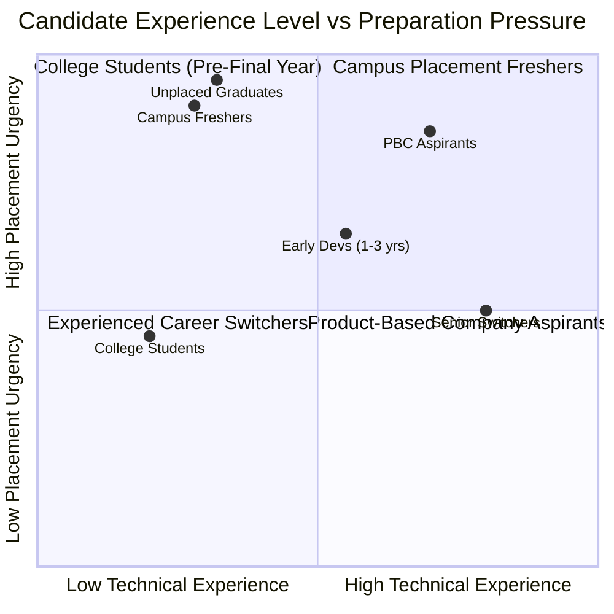
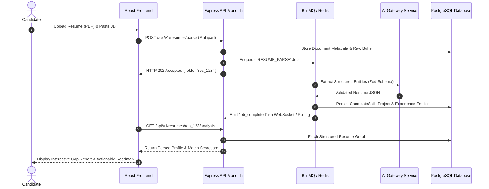

# TechQuery AI — User Personas & End-to-End User Journeys

**Document ID:** TQ-DOC-002  
**Version:** 1.0.0 (Production Rebuild)  
**Status:** Approved for Product Discovery  
**Author:** Product & Architecture Working Group  

---

## Part 1: Comprehensive User Personas

---

### Persona 1: The College Student (Pre-Final Year B.Tech / BCA)
- **Profile:** 3rd-year Computer Science student seeking summer internships. Strong theoretical concepts from coursework, but minimal industry exposure.
- **Goals:**
  - Understand how academic subjects (OS, DBMS, Computer Networks) are tested in actual company interviews.
  - Learn what practical projects make a resume stand out.
  - Build confidence before final-year campus drives begin.
- **Pain Points & Frustrations:**
  - Overwhelmed by generic advice on LinkedIn, YouTube, and LeetCode.
  - Does not know how to align coursework with market requirements.
  - Lack of access to experienced mentors for mock interviews.
- **Expectations:**
  - Fast, guided setup with minimal technical jargon.
  - Free or highly affordable access to basic question generation.
- **Primary Use Cases:**
  - Uploading college project resumes to identify missing modern skills (e.g., Docker, REST APIs).
  - Generating foundational DBMS, OS, and OOP questions.
- **Most Valuable Features:**
  - Topic-wise Question Bank, Resume Quality Audit, Step-by-Step Learning Roadmaps.
- **Potential Limitations:**
  - Limited exposure to complex distributed systems; will struggle with high-difficulty questions if not properly scaffolded.

---

### Persona 2: The Unplaced / Fresh Graduate (B.Tech / MCA / BCA)
- **Profile:** Recently graduated within the last 6 months; currently applying off-campus to hundreds of job listings with low response rates.
- **Goals:**
  - Fix resume to pass automated Applicant Tracking Systems (ATS).
  - Rapidly prepare for specific job openings within 24–48 hours of an interview callback.
  - Clear first-round technical screening calls.
- **Pain Points & Frustrations:**
  - Repeatedly rejected without constructive feedback.
  - Generic preparation doesn't match the specific stacks listed in niche startup JDs.
  - High anxiety and imposter syndrome during conversational interviews.
- **Expectations:**
  - Concrete diagnostics on why their resume doesn't match a specific JD.
  - Realistic mock interview simulations to build verbal fluency under pressure.
- **Primary Use Cases:**
  - Pasting a specific JD from Naukri/LinkedIn alongside their resume for instant gap analysis.
  - Practicing conversational technical questions before an off-campus call.
- **Most Valuable Features:**
  - Resume-JD Matching Engine, Interactive AI Mock Interviewer, Model Answers with Explanations.
- **Potential Limitations:**
  - High sensitivity to token limits and paywalls; easily churns if the free tier is too restrictive.

---

### Persona 3: The Campus Placement Candidate (Final Year Engineering)
- **Profile:** Final year student currently sitting for on-campus drives with service-based (TCS, Infosys, Wipro) and mass-hiring product firms (Accenture, Capgemini, Cognizant).
- **Goals:**
  - Master the high-frequency coding and conceptual questions asked by specific campus recruiters.
  - Confidently articulate college final-year capstone projects to interviewers.
  - Clear both technical rounds and conversational HR/managerial rounds.
- **Pain Points & Frustrations:**
  - Campus placement tests occur with only 12–24 hours of advance notice.
  - Difficulty answering "deep dive" questions into their own resume projects.
- **Expectations:**
  - Company-specific question tags (e.g., "Top 20 Questions for TCS Digital").
  - Instant PDF export of revision sheets to review offline on mobile devices.
- **Primary Use Cases:**
  - Generating project-specific defense questions ("Why did you use MongoDB instead of PostgreSQL?").
  - Exporting revision sheets to PDF before heading into an interview hall.
- **Most Valuable Features:**
  - Project-based Question Generation, PDF Export, Behavioral & HR Mock Simulations.
- **Potential Limitations:**
  - Intense spikes in usage during placement season (August–November) followed by drops in activity.

---

### Persona 4: Early Career Developer (1–3 Years Experience)
- **Profile:** Software engineer at a service company or early-stage startup looking for their first major lateral career jump to an established product firm.
- **Goals:**
  - Move from junior bug-fixing tasks to high-growth engineering roles with higher compensation.
  - Brush up on fundamental Data Structures & Algorithms and basic Low-Level Design (LLD).
  - Learn to explain production architectural trade-offs clearly.
- **Pain Points & Frustrations:**
  - Daily job work is routine and doesn't test the deep algorithmic and design skills required in interviews.
  - Little free time; cannot afford 4 hours a day on random coding puzzles.
- **Expectations:**
  - High signal-to-noise ratio: high-impact questions focused on mid-level expectations.
  - Realistic follow-up probing on system bottlenecks, caching, and database indexing.
- **Primary Use Cases:**
  - Simulating technical rounds with adaptive AI follow-up questions probing concurrency and indexing.
  - Auditing their professional resume to highlight quantified business impact instead of passive job duties.
- **Most Valuable Features:**
  - Adaptive Follow-up Probing in Mock Interviews, Sandboxed Coding Practice, Multi-dimensional Rubric Scoring.
- **Potential Limitations:**
  - Demands high accuracy and depth; easily frustrated by simplistic or generic AI answers.

---

### Persona 5: Experienced Developer Switching Stacks (3–7 Years Experience)
- **Profile:** Experienced backend or frontend engineer transitioning to a new paradigm (e.g., migrating from monolithic Java Spring to Go microservices, or moving into Cloud/DevOps).
- **Goals:**
  - Identify exact conceptual skill gaps between their existing mastery and target role expectations.
  - Gain confidence in answering senior-level scenario-based questions in their new target stack.
- **Pain Points & Frustrations:**
  - Knows senior software engineering principles, but lacks fluency in language-specific idioms and pitfalls.
  - Generic interview prep tools are too junior and waste time explaining basic loops and OOP.
- **Expectations:**
  - Advanced scenario-based questions (e.g., failure modes, distributed locking, observability).
  - Tailored roadmaps highlighting high-leverage transferable skills.
- **Primary Use Cases:**
  - Uploading resume with legacy experience + target modern JD to produce delta-gap reports.
  - Practicing architectural defense in mock simulations.
- **Most Valuable Features:**
  - Skill Delta Gap Analysis, System Design Scenario Questions, In-depth Technical Explanations.
- **Potential Limitations:**
  - Will thoroughly scrutinize AI-generated architectural trade-offs; requires rigorous model prompt validation.

---

### Persona 6: Product-Based Company (PBC) Aspirant (FAANG / Tier-1 Tech)
- **Profile:** Ambitious engineer targeting high-bar engineering organizations (Google, Amazon, Uber, Swiggy, Razorpay).
- **Goals:**
  - Master complex algorithmic patterns (Graphs, DP, Trees) under strict time and space constraints.
  - Excel in behavioral rounds using the STAR method (Situation, Task, Action, Result).
  - Practice real-time code execution with edge-case test cases.
- **Pain Points & Frustrations:**
  - Most AI tools give shallow coding hints or hallucinate edge cases.
  - Lack of an integrated coding environment with automated complexity validation.
- **Expectations:**
  - Isolated, low-latency code execution environment supporting multiple languages.
  - Rigorous evaluation rubrics assessing edge cases, time/space optimality, and code cleanliness.
- **Primary Use Cases:**
  - Live coding interview simulations with AI interviewer providing hints only when prompted.
  - Behavioral interview simulations with deep probing into leadership principles.
- **Most Valuable Features:**
  - Sandboxed Coding Sandbox, Algorithmic Complexity Audits, Behavioral STAR Evaluation Rubric.
- **Potential Limitations:**
  - Requires low-latency execution and high system uptime; expects zero tolerance for runtime crashes.

---

## Part 2: End-to-End User Journeys (Workflows 1 to 14)

---

### Journey 1: New User Registration & Verification
- **User Action:** User navigates to `/register`, enters name, email, strong password (or clicks "Continue with Google"), and clicks Submit.
- **Frontend Response:** Displays immediate visual loading spinner on button, disables inputs to prevent duplicate submission, and navigates to `/verify-email-pending` on success.
- **Backend Processing:** Validates payload with Zod schema (`AUTH-001`). Checks email uniqueness in PostgreSQL. Generates cryptographically secure random token (HMAC-SHA256, 24-hr TTL). Hashes password with bcrypt (cost factor 12). Stores user with `is_verified = false`. Enqueues verification email in BullMQ.
- **AI Processing:** None (pure deterministic auth).
- **Database Operations:** `INSERT INTO users (id, email, password_hash, is_verified, created_at) ...` and `INSERT INTO email_verification_tokens (...)`.
- **Expected Result:** User receives transactional verification email within 5 seconds; clicking link activates account and sets session JWT in HttpOnly cookie.
- **Failure Handling:** If email exists, returns `409 Conflict` with clear error: *"An account with this email already exists. Try logging in."* If email delivery fails, user can click *"Resend verification link"* with a 60-second rate-limit cooldown.

---

### Journey 2: First-Time Onboarding & Goal Profiling
- **User Action:** Authenticated user visits `/onboarding` (forced redirect if `profile_completed == false`). Selects education, experience band, target roles, preferred programming languages, and preparation timeline.
- **Frontend Response:** Displays an interactive multi-step progress wizard (Step 1: Education ➔ Step 2: Experience & Skills ➔ Step 3: Target Roles & Goals).
- **Backend Processing:** Validates payload against `ONBD-001` schema. Checks for valid enumeration values. Links selected skills to global `Skill` taxonomy in DB. Marks `user.profile_completed = true`.
- **AI Processing:** None in ingestion; deterministic profile mapping.
- **Database Operations:** `INSERT INTO user_profiles (...)`, `INSERT INTO candidate_skills (...)`.
- **Expected Result:** Profile saved; user is transitioned directly to `/dashboard` with pre-populated target role widgets.
- **Failure Handling:** If user abandons wizard midway, progress is saved in local draft state; next login prompts resume from last incomplete step.

---

### Journey 3: Resume Upload, Parsing & Quality Audit
- **User Action:** User drags and drops a PDF/DOCX resume file into `/resumes/upload`.
- **Frontend Response:** Checks file extension and client-side size (< 5MB). Displays progress bar (`Uploading... ➔ Scanning ➔ Parsing`).
- **Backend Processing:** Validates MIME type and magic bytes (`RES-001`). Checks file size. Saves raw file to secure Object Storage (S3/R2). Extracts raw text using deterministic parser (`pdf-parse` / `mammoth`). Sanitizes control characters. Enqueues `RESUME_PARSE_AUDIT` job in BullMQ.
- **AI Processing:** Background worker sends raw text to AI Gateway with structured Zod extraction schema:
  - Extracts personal info, educational history, employment timeline, tools, projects, and quantifiable metrics.
  - Performs ATS quality audit: calculates action-verb density, detects missing sections, flags passive phrasing, and highlights unquantified achievements.
- **Database Operations:** `INSERT INTO resumes (id, user_id, file_url, parsed_json) ...`, `INSERT INTO resume_analyses (id, resume_id, quality_score, issues_json) ...`.
- **Expected Result:** Within 6 seconds, user views structured resume breakdown: parsed skills, ATS health score (out of 100), and highlighted improvement suggestions.
- **Failure Handling:** If file is a scanned image with no extractable text, returns `422 Unprocessable Entity`: *"Scanned or image-only PDF detected. Please upload a text-based PDF or DOCX."*

---

### Journey 4: Job Description Submission & Decomposition
- **User Action:** User navigates to `/jd/new`, pastes raw text of target job posting (or enters title, company, and JD text), and clicks *"Analyze Job Description"*.
- **Frontend Response:** Shows input character counter (min 150 chars, max 10,000 chars). Displays skeleton loaders across analysis view.
- **Backend Processing:** Validates input length. Trims whitespace. Computes SHA-256 hash of text to detect identical previously parsed JDs (caching opportunity). Enqueues JD parsing job.
- **AI Processing:** AI Gateway extracts:
  - Core Role Title & Seniority Level (Junior, Mid, Senior, Lead).
  - Mandatory Must-Have Technical Skills.
  - Preferred / Nice-to-Have Skills.
  - Key Responsibilities & Domain Knowledge.
- **Database Operations:** `INSERT INTO job_descriptions (id, user_id, title, company, raw_text, structured_json) ...`.
- **Expected Result:** Structured breakdown displayed showing required competencies grouped by category (Languages, Frameworks, Databases, Tools, Architecture).
- **Failure Handling:** If pasted text is gibberish (< 150 characters or low word count), returns `400 Bad Request`: *"The provided text does not appear to be a valid job description. Please provide at least 150 characters detailing role responsibilities and requirements."*

---

### Journey 5: Resume-to-JD Match & Gap Analysis
- **User Action:** On `/match`, user selects one of their uploaded resumes and one saved JD, then clicks *"Run Match & Gap Analysis"*.
- **Frontend Response:** Displays radar chart skeleton loader with text: *"Analyzing skill overlap, project relevance, and experience alignment..."*
- **Backend Processing:** Fetches structured JSON of both Resume and JD. Calculates deterministic skill overlap (Exact Match vs Alias Match via Skill Taxonomy). Calls AI Gateway for qualitative semantic relevance scoring (`MATCH-001`).
- **AI Processing:** Evaluates semantic alignment:
  - Are candidate's projects relevant to the company's domain?
  - Does candidate have practical experience or just theoretical coursework?
  - Identifies High-Priority Missing Skills, Medium-Priority Gaps, and Strongest Matches.
  - Computes Match Index with explicit qualitative explanation.
- **Database Operations:** `INSERT INTO job_matches (id, resume_id, jd_id, match_score, matched_skills, missing_skills, analysis_json) ...`.
- **Expected Result:** Detailed Match Card displayed: Match percentage band (e.g., *"68% Alignment — Moderate Fit"*), breakdown of matching vs missing skills, and prioritized 7-day preparation recommendations.
- **Failure Handling:** Disclaims prominently that the score is a heuristic preparation guide, not an official hiring guarantee. If AI times out, falls back to deterministic skill-overlap percentage immediately with banner: *"Qualitative semantic analysis temporarily unavailable; showing direct keyword match."*

---

### Journey 6: Personalized Question Generation
- **User Action:** From Match Card or Question Studio, user clicks *"Generate Interview Questions"*. Configures: Count (10, 15, 20), Difficulty (Junior, Mid, Senior), Focus (Balanced, 70% Coding, 70% Theory, System Design).
- **Frontend Response:** Shows progress bar with animated phase updates (*"Analyzing resume projects... Generating coding challenges... Formatting explanations..."*).
- **Backend Processing:** Checks user's daily/monthly generation quota in Redis (`BILL-001`). Enqueues `QUESTION_GENERATION` job with payload containing candidate profile + target role.
- **AI Processing:** LLM prompt generates questions strictly conforming to Zod schema (`QGEN-001`):
  - Question text, category (Theoretical, Coding, System Design, Behavioral).
  - Difficulty level, target skill, interviewer intent ("Why this is asked").
  - Expected key concepts required for a complete answer.
- **Database Operations:** `INSERT INTO question_sets (id, user_id, title, context_meta) ...`, `INSERT INTO questions (id, set_id, question_text, category, difficulty, metadata_json) ...`.
- **Expected Result:** Clean list of categorized questions appears. Each question card features expandable tabs for Interviewer Intent, Key Concepts, and Generate Model Answer.
- **Failure Handling:** If LLM generates malformed JSON, retry mechanism triggers with higher temperature or fallback model (Groq ➔ OpenAI ➔ Gemini). If all fail, returns cached high-frequency questions for that skill domain with friendly user notice.

---

### Journey 7: Structured Answer & Explanation Generation
- **User Action:** User clicks *"Generate Model Answer"* on a specific question card.
- **Frontend Response:** Card expands with an in-place shimmer loader.
- **Backend Processing:** Checks if an answer already exists in DB for this question (`answers` table). If cached, returns immediately (< 50ms). Otherwise, checks AI token quota and invokes AI Gateway.
- **AI Processing:** Prompts AI with Question, Candidate Experience Level, and Target Domain:
  - Returns structured answer: Concise Summary (2–3 sentences), Deep Dive Explanation, Production Code Example (if applicable) with Time/Space Complexity analysis, Real-World Trade-Offs, and Common Pitfalls.
- **Database Operations:** `INSERT INTO answers (id, question_id, short_answer, detailed_explanation, code_example, time_complexity, space_complexity) ...`.
- **Expected Result:** Answer renders instantly with syntax-highlighted code block, complexity badges, and collapsible deep-dive sections.
- **Failure Handling:** If rate-limited, UI notifies user: *"AI generation capacity temporarily busy. Retrying in 5 seconds..."* and attempts exponential backoff.

---

### Journey 8: Saving & Organizing Question Collections
- **User Action:** User clicks bookmark icon on multiple questions and selects *"Add to Collection" ➔ "Create Collection: Razorpay SDE-1 Prep"*.
- **Frontend Response:** Instant optimistic UI update (bookmark icon turns solid indigo, toast notification confirms: *"Saved to collection"*).
- **Backend Processing:** Validates collection name (`LIB-001`). Creates collection if new, links selected question IDs in join table.
- **AI Processing:** None (pure database transactional operation).
- **Database Operations:** `INSERT INTO question_collections (...)`, `INSERT INTO collection_items (collection_id, question_id) ...`.
- **Expected Result:** Collection accessible under `/library/collections`, searchable by tags, and exportable to PDF.
- **Failure Handling:** If database write fails, optimistic UI reverts bookmark state and shows error toast: *"Could not save question. Please check network connection."*

---

### Journey 9: Configuring & Starting an Interactive Mock Interview
- **User Action:** User navigates to `/interviews/new`. Selects Type (Technical Round, Coding Round, HR/Behavioral), Difficulty (Junior, Mid, Senior), Duration (15 min / 5 questions, 30 min / 10 questions), and attaches their target JD. Clicks *"Begin Interview"*.
- **Frontend Response:** Full-screen interview chamber opens. Prompts user for camera/microphone permissions (optional; text-based supported natively). Displays test countdown timer and "Interviewer is reviewing your profile...".
- **Backend Processing:** Verifies user has remaining mock interview credits for billing cycle (`BILL-001`). Initializes `MockInterview` record with state `IN_PROGRESS`. Selects opening ice-breaker/introductory question.
- **AI Processing:** Evaluates candidate profile and target JD to formulate context-aware opening prompt.
- **Database Operations:** `INSERT INTO mock_interviews (id, user_id, type, target_role, status, started_at) ...`, `INSERT INTO interview_questions (id, interview_id, sequence_num, question_text) ...`.
- **Expected Result:** AI interviewer introduces itself in chat/voice UI: *"Hello! I'm your technical interviewer today. I see you've worked with Node.js and Redis. Could you walk me through how you handled cache invalidation in your recent project?"*
- **Failure Handling:** If user accidentally closes tab, session state remains active in Redis for 60 minutes. Re-opening URL displays modal: *"Resume ongoing interview or discard?"*

---

### Journey 10: Running & Completing an Interview Session
- **User Action:** Candidate types (or speaks via speech-to-text) their answer to the current question and clicks *"Submit Answer"*.
- **Frontend Response:** Answer displays in conversation thread. Typing indicator appears for AI Interviewer.
- **Backend Processing:** Appends candidate response to interview message log. Evaluates answer brevity/depth. Decides whether to ask a probing follow-up or move to the next topic (`MOCK-001`).
- **AI Processing:** Adaptive Dialogue Agent evaluates:
  - Did the user skip key concepts? If yes, formulate targeted follow-up: *"You mentioned caching user sessions, but what happens if the Redis node crashes? How do you maintain session persistence?"*
  - If answered comprehensively, transitions cleanly to next scheduled topic.
- **Database Operations:** `INSERT INTO interview_responses (id, interview_question_id, user_transcript, time_spent_sec) ...`.
- **Expected Result:** Conversational back-and-forth persists until target question count/time limit is reached. Interface announces interview conclusion and redirects to `/interviews/:id/evaluating`.
- **Failure Handling:** If user submits empty or single-word answer ("yes", "don't know"), interviewer gently prompts: *"Could you elaborate on your thought process or explain what approach you would consider?"*

---

### Journey 11: Reviewing Interview Performance & Scorecards
- **User Action:** User opens completed interview report on `/interviews/:id/report`.
- **Frontend Response:** Displays comprehensive interactive scorecard: Overall Readiness Score, Category Radar Chart (Correctness, Depth, Communication, Problem-Solving), Transcript Timeline with inline critique tags, and Actionable Remediation Plan.
- **Backend Processing:** Fetches completed `InterviewEvaluation` record from DB.
- **AI Processing:** Run asynchronously at session conclusion:
  - Evaluates each question-answer pair against standardized rubric.
  - Generates Model Ideal Answers for questions the user struggled with.
  - Recommends 3 specific learning modules to bridge observed gaps.
- **Database Operations:** `SELECT * FROM interview_evaluations WHERE interview_id = ...`.
- **Expected Result:** User inspects exact timestamps where their explanation was unclear, reads the ideal response, and clicks *"Add weak concepts to preparation roadmap"*.
- **Failure Handling:** Prominent advisory note displayed: *"AI interview evaluations simulate hiring bar criteria for practice purposes. Results should be treated as diagnostic feedback rather than a guarantee of actual company hiring outcomes."*

---

### Journey 12: Starting Coding Problem Practice & Sandboxed Evaluation
- **User Action:** User visits `/practice/coding/:problemId`. Selects language (JavaScript, Python, Java, C++). Writes algorithmic solution in Monaco Editor and clicks *"Run Code"* (tests against sample test cases) or *"Submit Solution"* (runs against hidden test cases).
- **Frontend Response:** Editor displays line numbers, syntax highlighting, and shortcuts. Output console displays execution status spinner: *"Executing in isolated sandbox..."*
- **Backend Processing:** Rate-limits submission rate (`CODE-001`). Packages user code + language runner script + test case inputs. Dispatches payload to isolated execution runner (Judge0 / gVisor container) with strict memory (128MB) and CPU (2.0s) limits.
- **AI Processing:** If requested by user, AI Hint Assistant provides progressive hints (Hint 1: Conceptual Direction ➔ Hint 2: Data Structure recommendation ➔ Hint 3: Edge Case reminder) without revealing the solution.
- **Database Operations:** `INSERT INTO coding_submissions (id, user_id, problem_id, code_snippet, language, status, execution_time_ms, memory_kb) ...`.
- **Expected Result:** Console displays per-test-case results (Passed / Failed / Time Limit Exceeded / Memory Limit Exceeded). On full pass, awards completion badge and updates user topic mastery score.
- **Failure Handling:** Malicious code (e.g., `os.system("rm -rf /")`, infinite while-loops, fork-bombs) is killed instantly by sandbox cgroups with zero impact on backend server; returns `Runtime Error / Resource Limit Exceeded`.

---

### Journey 13: Career Readiness & Learning Roadmap Exploration
- **User Action:** User navigates to `/career/roadmap`. Clicks *"Generate Target Role Roadmap: Backend Engineer (SDE-1)"*.
- **Frontend Response:** Displays an interactive milestone tree structured into weekly preparation sprints (Sprint 1: Core Languages & Concurrency ➔ Sprint 2: DB & Indexing ➔ Sprint 3: System Design & APIs).
- **Backend Processing:** Compares user's verified skills, resume analysis, and interview scores against benchmark requirements for the target role.
- **AI Processing:** Generates sequential learning milestones containing curated project ideas, core documentation links, and practice questions.
- **Database Operations:** `INSERT INTO preparation_plans (id, user_id, target_role, milestones_json) ...`.
- **Expected Result:** User can mark milestone tasks as complete, linking directly to relevant Question Bank topics and Coding Problems.
- **Failure Handling:** If user profile lacks sufficient data, system prompts: *"Upload a resume or complete a mock interview to calibrate your personalized roadmap."*

---

### Journey 14: Managing Account Tier, Usage Quotas & Subscriptions
- **User Action:** Free tier user reaches generation limit and clicks *"Upgrade to Pro"* on the quota modal.
- **Frontend Response:** Displays transparent pricing modal comparing Free vs Pro tier limits (Unlimited questions, 10 mock interviews/month, unlimited code runs).
- **Backend Processing:** Generates order payload for payment gateway (Razorpay for INR, Stripe for international). In V1, displays: *"Pro Tier is currently in early-access preview! You have been granted 5 bonus credits for testing."*
- **AI Processing:** None.
- **Database Operations:** `SELECT * FROM usage_records WHERE user_id = ...`, `UPDATE subscriptions ...`.
- **Expected Result:** User views real-time quota progress bars on `/settings/billing` (e.g., *"12/15 Question Sets Used This Month"*).
- **Failure Handling:** If quota exceeded, action is gracefully blocked with clear message explaining reset date: *"Monthly free quota reached. Resets on 1st of next month."*
