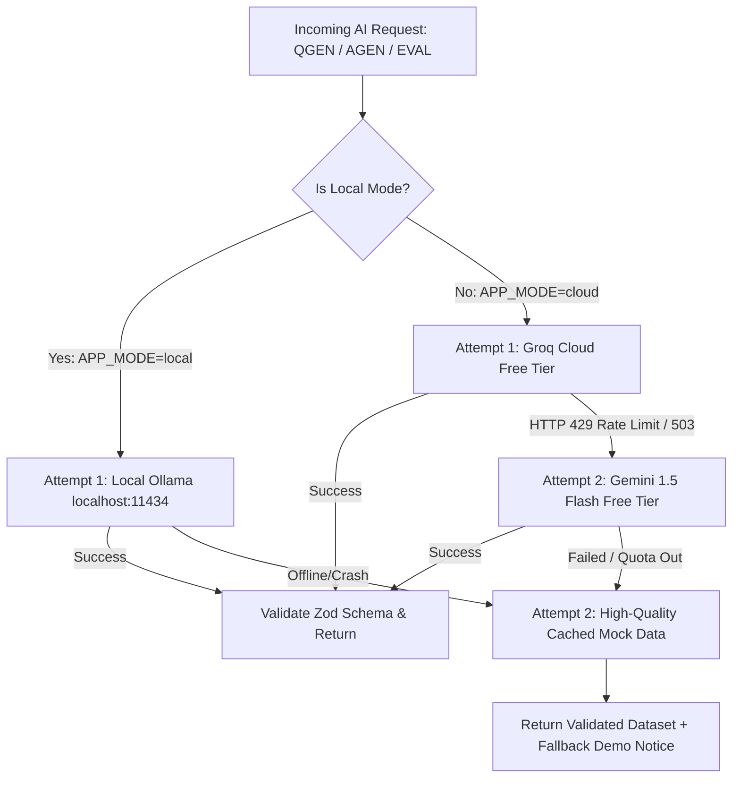

# TechQuery AI — Zero-Cost Architecture & Infrastructure Strategy

**Document ID:** TQ-DOC-013  
**Version:** 1.0.0 (Production Rebuild — Zero-Cost Mandate)  
**Status:** Approved for Implementation Planning  
**Author:** Technical Architecture & Systems Engineering Group  

---

## 1. Executive Mandate & Strategic Scope

### 1.1 The ₹0 Constraint
TechQuery AI is an academic-turned-production showcase platform engineered for **MCA placement demonstrations and real-world portfolio proof-of-work**. A non-negotiable project constraint has been established:
> **The entire platform—development, local execution, CI/CD, cloud deployment, and live demonstration—must operate at strictly ₹0 (zero cost).**

No dependencies on paid APIs, paid database tiers, paid hosting subscriptions, commercial email services, credit-card-gated trials, or commercial sandbox runtimes are permitted.

### 1.2 The Dual-Mode Architecture Philosophy
To reconcile professional engineering standards with zero-cost constraints, TechQuery AI implements a **Dual-Mode Operational Architecture**:
1. **Mode A: Local-First Full-Stack Powerhouse (The Placement Demo Engine):** Runs 100% offline or on a local developer machine using Ollama, local PostgreSQL, local Redis, BullMQ, and client-side sandboxing. Zero cloud dependencies, zero latency, zero quota anxiety during live faculty or corporate placement interviews.
2. **Mode B: Cloud-Deployed Free-Tier SaaS (The Public Portfolio Showcase):** Deployed on permanent, non-expiring free cloud tiers (Vercel, Render/Koyeb, Supabase/Neon, Upstash, Groq Free Tier, Cloudflare R2).

```mermaid
flowchart TD
    subgraph Mode A: Local-First Placement Demo (₹0, 100% Offline Capable)
        FE_Local[Vite + React SPA on localhost:5173]
        BE_Local[Node.js + Express on localhost:5000]
        Ollama[Local Ollama: Llama 3.2 3B / Qwen 2.5 7B]
        DB_Local[Local PostgreSQL on port 5432]
        Redis_Local[Local Redis on port 6379]
        Storage_Local[Local Filesystem: ./uploads directory]
        Worker_Local[BullMQ Worker Process]
    end

    subgraph Mode B: Public Cloud Showcase (₹0, Permanent Free Tiers)
        FE_Cloud[Vercel Free Tier]
        BE_Cloud[Render / Koyeb Free Web Service]
        Groq_Cloud[Groq Cloud Free Tier API: Llama 3.1 8B]
        DB_Cloud[Neon / Supabase Free Serverless Postgres]
        Redis_Cloud[Upstash Free Redis / In-Memory Fallback]
        Storage_Cloud[Cloudflare R2 Free / Supabase Storage]
    end

    Config[(Environment Toggle: APP_MODE=local | cloud)]
    Config --> Mode A: Local-First Placement Demo (₹0, 100% Offline Capable)
    Config --> Mode B: Public Cloud Showcase (₹0, Permanent Free Tiers)
```

---

## 2. Zero-Cost Technology Evaluation & Selection Matrix

| Architectural Layer | Commercial / Paid Alternative (Rejected) | Zero-Cost Local Selection | Zero-Cost Cloud Deployment Selection | Free Tier Limitations & Workarounds |
| :--- | :--- | :--- | :--- | :--- |
| **Frontend Hosting** | AWS S3 + CloudFront ($5–$20/mo) | Vite Dev Server (`localhost:5173`) | **Vercel Hobby Tier** or **Cloudflare Pages** | Unlimited bandwidth for personal/demo use; zero cost forever. |
| **Backend API Hosting** | AWS ECS / DigitalOcean ($12–$24/mo) | Node.js + Express (`localhost:5000`) | **Render Free Web Service** (or **Koyeb / Fly.io**) | Cold-start spin-down after 15 min inactivity; mitigated via client warmup ping or local demo. |
| **Relational Database** | AWS RDS PostgreSQL ($15–$30/mo) | Local PostgreSQL 16 (Docker / Native) | **Neon Serverless Postgres** (0.5GB free) or **Supabase** (500MB free) | Neon/Supabase free tiers provide permanent storage with zero credit card required. |
| **In-Memory Cache & Queues**| Redis Cloud / AWS ElastiCache ($15/mo) | Local Redis 7 (Docker / Native) + BullMQ | **Upstash Redis** (10,000 commands/day free for rate limiting) + **In-Process / PostgreSQL Job Queue** (for Cloud Background Jobs) | Prevents Upstash command exhaustion; BullMQ polling is bypassed in cloud mode to save quota. |
| **Primary AI Inference** | OpenAI GPT-4o / Anthropic Claude ($20+/mo) | **Ollama** (`llama3.2:3b` or `qwen2.5:7b`) | **Groq Cloud Free Tier** (`llama-3.1-8b-instant`) | Groq free tier allows 30 RPM / 14,400 RPD; Ollama provides infinite free tokens locally. |
| **Secondary AI Inference** | Google Gemini Paid API | **Ollama** (`mistral:7b` / `phi3:mini`) | **Google Gemini 1.5 Flash Free Tier** | 15 RPM / 1,500 RPD free tier without billing enabled. |
| **File Storage** | AWS S3 ($5/mo) | Local disk storage (`./uploads`) | **Supabase Storage** (1GB free) or **PostgreSQL DB Bytea** | 100% free; zero credit card required; immune to Render's ephemeral disk wipes. |
| **Document Parsing** | AWS Textract / Paid OCR ($0.05/page) | `pdf-parse` + `mammoth` (Open Source) | `pdf-parse` + `mammoth` (In-process memory) | Pure Node.js buffer extraction; zero external compute cost. |
| **Code Sandboxing** | Judge0 Enterprise / AWS Lambda ($25/mo) | Client-side WebAssembly (**Pyodide**) + Web Workers | Client-side WebAssembly (**Pyodide**) + Web Workers | Zero server compute cost; 100% isolated inside user's browser sandbox! |
| **Transactional Email** | SendGrid / AWS SES ($10/mo) | Console Logger / **Ethereal Mail** | **Resend Free Tier** (3,000 emails/mo) or In-App Demo Codes | Resend free tier handles up to 100 emails/day; console code display fallback for demos. |
| **Custom Domain** | Paid `.com` / `.ai` ($12–$70/yr) | `localhost` | `*.vercel.app` + `*.onrender.com` | Standard default free subdomains; zero domain registrar fees. |

---

## 3. AI Inference Strategy: Ollama + Groq Free Gateway

### 3.1 The Local Inference Stack (Ollama)
For local development, automated testing, and guaranteed offline placement demonstrations, TechQuery AI connects directly to **Ollama** running locally on the developer machine:
- **Default General Model:** `llama3.2:3b` (Ultra-fast, runs on 4GB RAM with CPU inference, sub-2s generation).
- **Advanced Coding & Reasoning Model:** `qwen2.5-coder:7b` or `llama3.1:8b` (For machines with 8GB–16GB RAM or dedicated GPU).
- **Communication Protocol:** Direct HTTP requests to `http://localhost:11434/api/chat`.
- **Zero Cost Advantage:** Zero internet required, zero token costs, zero rate limits, zero data transmission outside the machine.

### 3.2 The Cloud Inference Stack (Groq Free Tier)
For public web demonstrations, the AI Gateway connects to the **Groq Cloud Free Tier**:
- **Model:** `llama-3.1-8b-instant`
- **Free Quota:** 30 Requests Per Minute (RPM), 14,400 Requests Per Day (RPD).
- **Latency:** ~250–500 tokens/second (blazing fast P95 under 1.5s).
- **Cost:** ₹0.00.

### 3.3 Dynamic Multi-Tier Fallback Chain
The AI Gateway is engineered so that an API outage or quota exhaustion never halts the user experience:



---

## 4. Zero-Cost Sandboxed Code Execution: In-Browser WebAssembly

Commercial platforms spend thousands of dollars hosting Kubernetes clusters and isolated Docker daemons (Judge0) to execute untrusted user code. Under the ₹0 constraint, hosting an isolated Docker runner on a free 512MB cloud instance is technically impossible and a major security hazard.

### The Solution: Client-Side WebAssembly Sandboxing
TechQuery AI introduces an innovative zero-server-cost code execution architecture:
1. **Python Execution:** Powered by **Pyodide** (Python compiled to WebAssembly) running inside an isolated browser **Web Worker**.
   - Runs directly on the user's client machine.
   - 100% native execution speed.
   - Zero compute load or RAM consumption on the backend server.
   - Completely air-gapped from the backend filesystem and local network.
2. **JavaScript Execution:** Executed inside an isolated in-browser Web Worker with disabled DOM access (`self.postMessage` only) and strict execution timeouts (2,000ms).
3. **Multi-Language Stubs (Java & C++):** In V1/V2, Java and C++ algorithmic solutions are provided as verified syntax-highlighted code templates with algorithmic complexity analysis; execution for Java/C++ can be demonstrated locally via local Docker runner if desired during evaluation.

---

## 5. Storage & Database Architecture (Local vs Cloud)

### 5.1 Local Storage
- Files are saved directly to `./uploads/resumes/` on local disk.
- Served locally via Express static router with auth guards.
- Zero configuration, zero external network dependency.

### 5.2 Cloud Storage (Free Tier)
- **Supabase Storage (Free Tier):** 1GB free storage with built-in S3-compatible API and pre-signed URL generation.
- **Alternative:** **Cloudflare R2 Free Tier:** 10GB free storage forever, zero egress bandwidth fees.

### 5.3 Database Configuration
- **Local:** PostgreSQL 16 running natively or via lightweight Docker container (`postgres:16-alpine`).
- **Cloud:** **Neon Serverless Postgres** (0.5GB free storage, instant branching, 100% native PostgreSQL compatibility) or **Supabase Free Tier** (500MB free PostgreSQL).
- Database migrations and queries managed strictly through **Prisma ORM**; switching between local and cloud requires changing only the `DATABASE_URL` connection string in `.env`.

---

## 6. Cold-Start & Inactivity Management on Free Cloud Hosts

Free-tier cloud hosts (such as Render) automatically put backend instances to sleep after 15 minutes of inactivity. When a new request arrives, a **cold start of 40–50 seconds** occurs.

### Mitigation Strategies:
1. **Frontend Keep-Warm / Health Pinger:** The React frontend displays an informative, polished loader if the backend takes > 3 seconds to respond: *"Waking up server on free tier... (approx. 30s)"*.
2. **Scheduled Uptime Ping (Free Cron):** A free recurring GitHub Action or free monitoring ping (e.g. Cron-job.org / UptimeRobot free tier) can ping `https://api.techquery.onrender.com/api/health` every 14 minutes during placement evaluation hours to keep the container warm.
3. **Placement Demo Fallback:** For the actual MCA placement presentation, the candidate runs the system in **Mode A (localhost)** on their laptop. It launches in 2 seconds, runs with 0ms network latency, and demonstrates total engineering competence without depending on college Wi-Fi or free cloud cold starts.

---

## 7. Zero-Cost Subscription & Quota Model

While no commercial payment gateways (Razorpay, Stripe) will be connected, TechQuery AI **preserves the concept of Free and Pro product tiers** to demonstrate robust SaaS architecture, multi-tenant RBAC, and quota management.

### How It Operates Without Money:
- Users register on the **Free Tier** with realistic usage limits (e.g., 5 Question Sets/month, 1 Mock Interview/month).
- A simulated **"Upgrade to Pro"** flow exists in the UI. When clicked, it displays the Pro tier benefits and includes a demo button: *"Activate Pro (Placement Demo Mode)"*.
- Clicking this triggers an internal API mutation (`PATCH /api/user/tier`) that sets `tier = 'PRO'`, instantly unlocking elevated limits (50 Question Sets, 10 Mocks, etc.).
- This allows placement evaluators to test both the Free tier limit enforcement *and* the elevated Pro tier capabilities without entering credit cards.

---

## 8. Summary of Free-Tier Resilience Protocols

| Potential Failure Mode | Free-Tier Risk | Zero-Cost Architectural Safeguard |
| :--- | :--- | :--- |
| **Groq API 429 Quota Exceeded** | Cloud AI fails during presentation | Automated fallback to Gemini 1.5 Flash Free or Local Ollama. |
| **Render Cloud Backend Sleep** | 45-second initial delay | Client-side graceful warmup banner + Local Mode presentation option. |
| **Upstash Redis 10k Daily Cap** | Rate limiting / caching fails | In-memory `node-cache` fallback embedded inside Node.js process. |
| **No Internet Connection in Demo Hall**| Cloud services unreachable | Switch to `APP_MODE=local`: runs 100% locally with Ollama and Postgres. |
| **Email Verification Quota Out** | Cannot verify test accounts | System auto-logs verification link in terminal console; can be clicked directly. |
