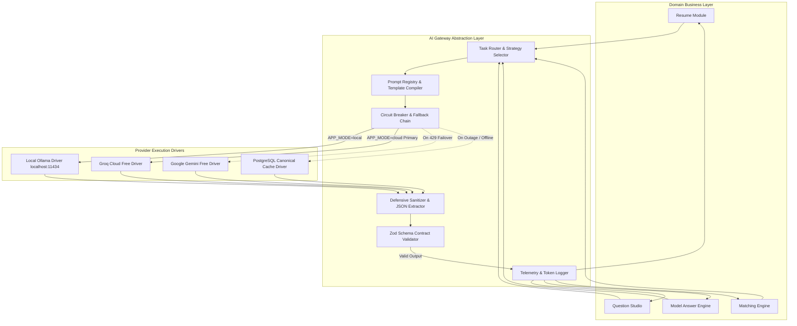
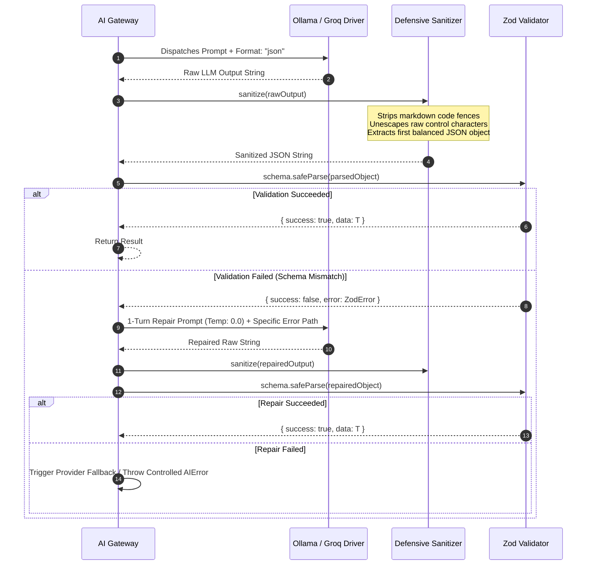

# TechQuery AI — AI Gateway Architecture & Inference Subsystem

**Document ID:** TQ-ARCH-007  
**Version:** 1.0.0 (System Design Phase)  
**Author:** Principal AI Systems Engineer & Software Architect  
**Status:** Approved for Implementation Planning  
**Operating Principle:** Decoupled, Provider-Agnostic, Zero-Cost Inference Gateway  

---

## 1. Gateway Design Philosophy

The legacy prototype imported `groq-sdk` directly into an Express route controller and parsed outputs using fragile regex string manipulation.

TechQuery AI establishes a **centralized, decoupled AI Gateway Service**. Business domain modules (`ResumeService`, `QuestionService`, `MatchingService`) never communicate with external AI providers or SDKs directly. All generative tasks route through a unified gateway interface.



---

## 2. Hardware-Dependent Local Model Selection Strategy

Running local LLMs via Ollama depends heavily on the host machine's physical hardware: CPU instruction set (AVX2/AVX-512), memory bandwidth (DDR4 vs DDR5 vs Apple Unified Memory), and available RAM.

| Developer Machine Hardware Profile | Recommended Local Model | Model Disk Size | Estimated Working RAM | Observed CPU Latency Range | Practical Suitability & Constraints |
| :--- | :--- | :--- | :--- | :--- | :--- |
| **Profile 1: Budget Laptop (8GB System RAM, 4 CPU Cores)** | **`llama3.2:3b` (Default)** | ~2.0 GB | **~2.2 GB – 2.8 GB** | Highly variable (10–22 t/s on modern Intel/AMD; slower if thermal throttling) | **Universal Baseline.** Fits within 8GB systems without triggering aggressive disk paging. Recommended for all student laptops. |
| **Profile 2: Standard Laptop (16GB RAM or Dedicated GPU)** | **`qwen2.5-coder:7b`** | ~4.7 GB | **~5.5 GB – 6.5 GB** | 25–45 t/s (NVIDIA CUDA) / 5–9 t/s (CPU only) | **Coding Specialist.** Outstanding algorithmic code formatting, but CPU-only inference on older laptops will feel noticeably sluggish. |
| **Profile 3: Apple Silicon (M1/M2/M3/M4 with 8GB–16GB Unified RAM)** | **`llama3.1:8b`** or **`qwen2.5-coder:7b`** | ~4.9 GB | **~5.5 GB – 6.5 GB** | 28–45 t/s (Metal Accelerated) | Runs smoothly leveraging unified memory architecture. |

> **Default Configuration:** `AI_LOCAL_MODEL="llama3.2:3b"` is the default in `.env.example`. This ensures that any evaluator cloning the repository on an 8GB machine can run the platform without out-of-memory lockups.

---

## 2.1 Cloud AI Free-Tier Availability & Verification Notice

> **CRITICAL VERIFICATION DISCLAIMER:**  
> Cloud AI providers (Groq Cloud, Google Gemini) offer free developer tiers as of 2026, but **their free-tier limits, model availability, and rate caps are UNVERIFIED for permanent operation** and can be modified or discontinued at the vendor's discretion without notice.  
> - **Groq Free Tier:** Provides high-throughput inference on `llama-3.1-8b-instant` (nominally 30 RPM / 14,400 RPD), but can experience sudden 429 throttling under shared load.  
> - **Zero Dependency Mandate:** TechQuery AI's primary architecture is **Mode A (Local Ollama)**. The application must never rely on cloud AI APIs to be functional during placement evaluations.

---

## 3. Provider Abstraction Contracts & Interfaces

```typescript
export interface AICompletionOptions {
  taskType: "RESUME_PARSE" | "ATS_AUDIT" | "JD_DECOMPOSE" | "MATCH_ANALYSIS" | "QGEN" | "AGEN";
  temperature?: number;
  maxTokens?: number;
  userId?: string;
}

export interface AIGatewayResult<T> {
  success: boolean;
  data: T;
  provider: "OLLAMA" | "GROQ" | "GEMINI" | "DATABASE_CACHE";
  modelName: string;
  latencyMs: number;
  inputTokens: number;
  outputTokens: number;
  isFallback: boolean;
}

export interface IAIGateway {
  executeTask<T>(
    options: AICompletionOptions,
    contextPayload: Record<string, unknown>,
    schema: z.ZodSchema<T>
  ): Promise<AIGatewayResult<T>>;
}
```

---

## 4. Structured JSON Output Contracts for Critical Workflows

Every workflow enforces an explicit, strongly-typed Zod schema before persisting to the database.

### 4.1 Question Generation Contract (`QGEN`)
```typescript
export const QuestionItemSchema = z.object({
  category: z.enum(["THEORETICAL", "CODING", "SYSTEM_DESIGN", "BEHAVIORAL", "PROJECT_DEFENSE"]),
  difficulty: z.enum(["EASY", "MEDIUM", "HARD"]),
  targetedSkill: z.string().min(2).max(100),
  questionText: z.string().min(15).max(600),
  interviewerIntent: z.string().min(15).max(400),
  keyEvaluationPoints: z.array(z.string().min(5).max(200)).min(2).max(5),
});

export const QuestionSetResponseSchema = z.object({
  title: z.string().min(5).max(200),
  topicFocus: z.string().min(3).max(100),
  questions: z.array(QuestionItemSchema).min(10).max(20),
});
```

### 4.2 Model Answer Generation Contract (`AGEN`)
```typescript
export const ModelAnswerResponseSchema = z.object({
  shortSummary: z.string().min(20).max(500),
  detailedExplanation: z.string().min(100).max(3000),
  codeSnippet: z.string().nullable().optional(),
  timeComplexity: z.string().max(50).nullable().optional(),
  spaceComplexity: z.string().max(50).nullable().optional(),
  commonMistakes: z.array(z.string().min(10).max(250)).min(1).max(5),
});
```

### 4.3 ATS Quality Audit Contract (`ATS_AUDIT`)
```typescript
export const ATSAuditResponseSchema = z.object({
  atsScore: z.number().int().min(0).max(100),
  strengths: z.array(z.string().min(10).max(200)),
  issues: z.array(z.string().min(10).max(250)),
  improvements: z.array(
    z.object({
      original: z.string(),
      suggested: z.string(),
      reason: z.string(),
    })
  ).min(1).max(10),
});
```

---

## 5. Defensive Parsing, Validation & Auto-Repair Lifecycle



---

## 6. Failure Modes & Graceful Degradation Protocols

| Failure Scenario | Root Cause | Gateway Operational Safeguard |
| :--- | :--- | :--- |
| **Ollama Service Down** | Developer forgot to run `ollama serve` | Returns clear, actionable error: `OLLAMA_UNAVAILABLE: Please run 'ollama serve' in your terminal.` In demo mode, falls back to pre-validated database cache with `is_fallback: true`. |
| **Model Not Downloaded** | Model tag missing in Ollama | Detects HTTP 404 from Ollama; returns: `MODEL_NOT_FOUND: Run 'ollama pull llama3.2:3b' to install.` |
| **Groq 429 Rate Limit** | Burst request limit (> 30 RPM) reached on Cloud | Circuit breaker trips for 60s; automatically routes request to Google Gemini 1.5 Flash Free Tier or serves cached DB sets. |
| **Model Generation Timeout**| Host CPU saturated / external network hang | Gateway enforces strict per-task timeouts (6s for answers, 10s for question sets). On timeout, aborts request via `AbortController` and executes fallback. |
| **Malformed JSON Unrepairable**| LLM generates unparseable text | The error is caught before touching the database. Never corrupts relational records; transaction rolls back and UI shows: *"AI response could not be verified. Please retry."* |
