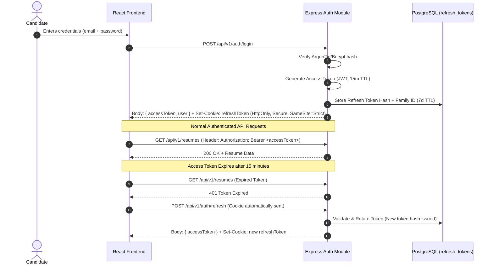

# TechQuery AI — Authentication & Identity Architecture

**Document ID:** TQ-ARCH-006  
**Version:** 1.0.0 (System Design Phase)  
**Author:** Principal Security Architect & Backend Engineering Group  
**Status:** Approved for Implementation Planning  
**Operating Principle:** Secure, Zero-Cost Session Management  

---

## 1. Authentication Strategy: Short-Lived Access Token + HttpOnly Refresh Rotation

### 1.1 Evaluated Alternatives & The Selection
The legacy app stored unhashed plain tokens in `localStorage`, exposing candidates to token theft via Cross-Site Scripting (XSS).

| Approach | Security Profile | XSS Vulnerability | CSRF Vulnerability | Operational Complexity | Audit Verdict |
| :--- | :--- | :--- | :--- | :--- | :--- |
| **A: Pure localStorage JWT** | Low | High (Any XSS steals session) | Zero | Trivial | **REJECTED** |
| **B: Stateful Server Sessions**| High | Low | Medium | Requires persistent Redis session store | **REJECTED (Exceeds free limits)** |
| **C: Dual-Token Hybrid (Selected)**| **High** | **Low (Refresh token unreadable by JS)** | **Mitigated (SameSite + Origin Check)** | Low (Stateless verification) | **APPROVED** |



---

## 2. Password Hashing Specification

- **Algorithm:** `bcrypt` (work factor 10 for Render free 512MB RAM compatibility, or `argon2id` if native binary compilation is supported on host).
- **Work Factor Justification:** Salt rounds of 10 require ~65–85ms per hash on a single core, offering high resistance to offline dictionary attacks while preventing CPU denial-of-service on free-tier servers.
- **Validation Rules:** Minimum 8 characters, at least 1 uppercase letter, 1 lowercase letter, 1 number, and 1 special symbol (`@$!%*?&`).

---

## 3. Refresh Token Family Tracking & Anti-Theft Rotation

To prevent stolen refresh token replay:
1. Every new login generates a unique `family_id` (UUIDv4) and an initial refresh token.
2. When the refresh token is presented at `/auth/refresh`:
   - If the token is valid and unrevoked, it is marked `is_revoked = true`, and a new refresh token is issued within the same `family_id`.
   - **Reuse Detection (Anti-Theft):** If a token marked `is_revoked = true` is ever presented again, the system detects a breach (someone replayed a consumed token). The backend **immediately invalidates all tokens sharing that `family_id`**, terminating all active sessions for that candidate.

---

## 4. Email Verification & Password Reset (Zero-Cost Protocols)

### 4.1 Mode A: Local Placement Demo Bypass
In `APP_MODE=local`, requiring real email delivery can fail due to college Wi-Fi or unconfigured SMTP.
- **Protocol:** The auth service detects `APP_MODE=local` and **prints the verification link directly to the terminal console**:
  ```text
  [LOCAL DEV AUTH] Account verification link for candidate@example.com:
  --> http://localhost:5173/verify-email?token=3a8b9c...
  ```
  The candidate simply clicks the link in their terminal to verify the account instantly.

### 4.2 Mode B: Cloud Showcase (Resend Free Tier)
- Uses **Resend Free Tier** (100 emails/day, 3,000/month free, no credit card required) to deliver transactional verification and password reset emails.
- If the daily quota is exhausted, the system logs the token in server stdout as a failsafe.

---

## 5. Security Cookie Configurations (Local vs Cloud)

```typescript
export const getRefreshTokenCookieOptions = () => {
  const isProduction = process.env.NODE_ENV === "production";
  return {
    httpOnly: true,                                // Inaccessible to document.cookie (prevents direct credential extraction via script)
    secure: isProduction,                          // HTTPS only in production; HTTP allowed on localhost
    sameSite: isProduction ? ("strict" as const) : ("lax" as const), // Mitigates CSRF
    maxAge: 7 * 24 * 60 * 60 * 1000,               // 7 days in milliseconds
    path: "/api/v1/auth",                          // Scoped strictly to auth endpoints
  };
};
```

> **IMPORTANT SECURITY NOTE ON XSS & HTTPONLY:**  
> Storing refresh tokens in `HttpOnly` cookies prevents malicious JavaScript from reading or exfiltrating the raw token value via `document.cookie`. However, **HttpOnly cookies do NOT render an application immune to XSS**. If an attacker achieves script execution within the application origin, they can still execute authenticated actions by dispatching `fetch()` or `XMLHttpRequest` requests (which automatically attach the cookie) or by tampering with DOM interfaces. Comprehensive XSS defense requires strict input validation, React JSX auto-escaping, Content Security Policy (CSP), and `rehype-sanitize` on all rendered markdown.

---

## 6. Tenant Data Isolation Guard

All controller endpoints pass through the `protect` middleware, which attaches the verified candidate object to `req.user`:
```typescript
export const protect = async (req: Request, res: Response, next: NextFunction) => {
  const authHeader = req.headers.authorization;
  if (!authHeader?.startsWith("Bearer ")) {
    return res.status(401).json({ success: false, error: { code: "UNAUTHORIZED", message: "Token missing" } });
  }

  const token = authHeader.split(" ")[1];
  try {
    const decoded = jwt.verify(token, process.env.JWT_ACCESS_SECRET!) as { userId: string; role: string; tier: string };
    req.user = decoded;
    next();
  } catch (err) {
    return res.status(401).json({ success: false, error: { code: "UNAUTHORIZED", message: "Token expired or invalid" } });
  }
};
```
Every subsequent service operation enforces `where: { id, userId: req.user.userId }`, guaranteeing zero cross-user data leakage.
