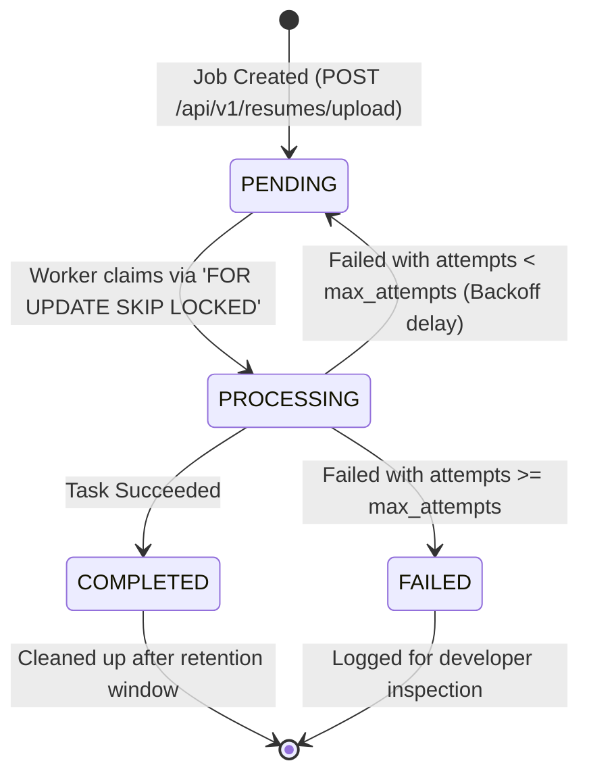

# TechQuery AI — Background Job & Asynchronous Queue Architecture

**Document ID:** TQ-ARCH-008  
**Version:** 1.0.0 (System Design Phase)  
**Author:** Principal Systems Architect & DevOps Engineer  
**Status:** Approved for Implementation Planning  
**Operating Principle:** Zero-Cost Asynchronous Processing (DB Queue & In-Process Pool)  

---

## 1. Asynchronous Task Identification

Certain application workloads consume between 2 and 10 seconds of processing time. Executing these synchronously within an HTTP request thread risks blocking client sockets, triggering proxy gateway timeouts (e.g. Render 30s HTTP timeout), and degrading UI responsiveness.

### 1.1 Tasks Requiring Background Processing
1. **Resume File Parsing & Entity Structuring (`RESUME_PARSE`):** File buffer extraction (`pdf-parse`) followed by LLM schema structuring (~3.0–5.5s).
2. **ATS Quality & Google X-Y-Z Audit (`ATS_AUDIT`):** Qualitative line-by-line review of all resume bullet points (~2.5–4.0s).
3. **Personalized 15–20 Question Synthesis (`QGEN`):** Multi-factor question generation across 4 distinct categories (~3.5–6.0s).
4. **Automated Job Queue Cleanup (`QUEUE_CLEANUP`):** Periodic purge of completed jobs older than 7 days.

---

## 2. Queue Architecture Comparison & Selection

| Architectural Pattern | Infrastructure Dependency | Free-Tier Feasibility | Operational Complexity | Audit Verdict |
| :--- | :--- | :--- | :--- | :--- |
| **A: BullMQ over Redis Cloud** | Redis server | **FAILED on Cloud** (Upstash 10k commands burned in hours by polling) | High | Local Mode only |
| **B: PostgreSQL `SKIP LOCKED` Queue (Selected)** | Existing PostgreSQL DB | **100% Zero-Cost** (0 external services, 0 network hops) | Low | **APPROVED FOR CLOUD** |
| **C: In-Process Queue (`p-limit`)** | Node.js Process Memory | **100% Zero-Cost** (Runs inside API process) | Lowest | **APPROVED FOR LOCAL** |



---

## 3. PostgreSQL-Backed Queue Engine (`job_queue`)

### 3.1 The Atomic Claiming Mechanism
To prevent race conditions when multiple worker threads or process replicas run concurrently, workers claim pending jobs using PostgreSQL's native row-level lock skipping:

```sql
-- Atomic Worker Claim Query
UPDATE job_queue
SET 
    status = 'PROCESSING',
    locked_at = NOW(),
    locked_by = :workerId,
    attempts = attempts + 1
WHERE id = (
    SELECT id
    FROM job_queue
    WHERE status = 'PENDING'
      AND run_at <= NOW()
    ORDER BY priority DESC, created_at ASC
    LIMIT 1
    FOR UPDATE SKIP LOCKED
)
RETURNING *;
```

### 3.2 Key Technical Advantages of `SKIP LOCKED`
1. **Zero External Dependencies:** Runs natively inside the existing PostgreSQL database (Local or Neon Serverless). Zero Redis dependencies.
2. **Zero Polling Quota Cost:** Queries execute against the relational database via indexed B-Tree scans (`idx_job_queue_fetch`), consuming 0 external Redis API units.
3. **Transactional Safety:** Job state changes can participate in the same ACID database transaction as business entities. If creating a `Resume` fails, the `RESUME_PARSE` job is never enqueued.

---

## 4. Job Lifecycle & Retry Policies

### 4.1 Exponential Backoff Formula
When an unhandled exception occurs (e.g. transient Groq rate limit), the worker calculates the next execution time:
$$\text{delaySeconds} = 2^{\text{attempts}} \times 5 \quad (\text{Attempt 1: 10s}, \text{Attempt 2: 20s}, \text{Attempt 3: 40s})$$

```typescript
export const calculateBackoff = (attempts: number): Date => {
  const delaySec = Math.pow(2, attempts) * 5;
  return new Date(Date.now() + delaySec * 1000);
};
```

### 4.2 Failure Handling & Dead-Letter State
- If `attempts >= maxAttempts` (default: 3), the job transitions to `status = 'FAILED'`.
- The exact stack trace and error message are persisted in `job_queue.error_message`.
- The associated domain entity (e.g. `resumes.status`) transitions to `'FAILED'`, allowing the client UI to display: *"Resume extraction could not be completed. Please re-upload or try again."*

---

## 5. Polling & Concurrency Controls

- **Worker Concurrency:** Limited to **2 concurrent jobs** per Node.js instance on free-tier containers to guarantee RAM stays well within the Render 512MB limit.
- **Adaptive Polling Interval:**
  - Active Queue: 500ms between job pickups.
  - Idle Queue: Exponential backoff up to 5,000ms polling interval when no pending jobs exist, minimizing CPU utilization on free cloud hosts.
