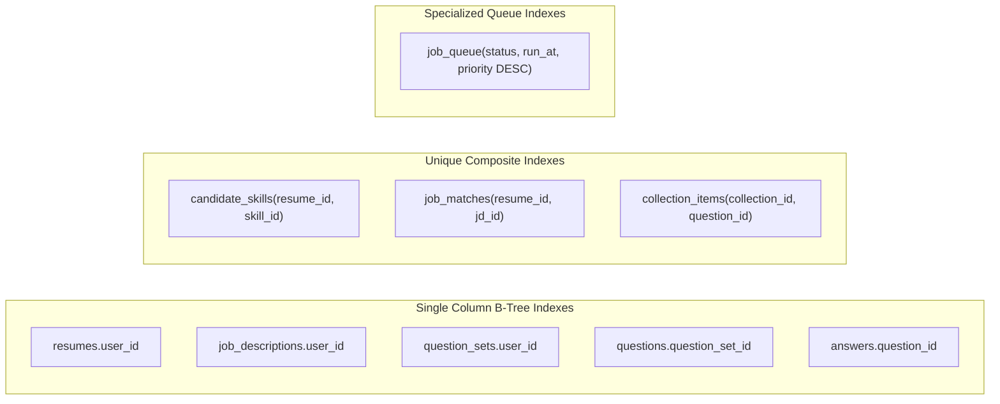

# TechQuery AI — Database Architecture & Data Modeling Strategy

**Document ID:** TQ-ARCH-002  
**Version:** 1.0.0 (System Design Phase)  
**Author:** Principal Database Architect & Systems Engineering Group  
**Status:** Approved for Implementation Planning  
**Target Engine:** PostgreSQL 16+ via Prisma ORM  

---

## 1. Database Selection Rationale

### 1.1 Why PostgreSQL Over MongoDB
The legacy prototype used MongoDB Atlas with Mongoose. While suitable for early schema experimentation, MongoDB is structurally deficient for TechQuery AI's relational domain:
1. **Relational Data Integrity:** TechQuery AI's domain model is strictly relational: a `User` owns `Resumes`, which link to `CandidateSkills` and `JobMatches`, which generate `QuestionSets`, containing `Questions` with permanently linked `Answers`. Orphaned records and inconsistent state in NoSQL document stores create severe bugs.
2. **ACID Transactions:** Financial quotas, multi-question batch saves, and cascade deletions require atomic multi-table transactions (`prisma.$transaction`).
3. **Hybrid Relational + JSONB Flexibility:** PostgreSQL combines strict foreign-key integrity with high-performance `JSONB` columns. Structured AI outputs (e.g., categorized question intent arrays, ATS health issue breakdowns) are stored as indexed `JSONB` documents without requiring arbitrary join tables, while core entities maintain strict relational foreign keys.
4. **Portability between Local and Cloud:** Using Prisma with PostgreSQL allows switching between **Local PostgreSQL** (`localhost:5432`) and **Neon Serverless PostgreSQL** (free cloud) by modifying only the `DATABASE_URL` connection string.

---

## 2. Naming Conventions & Design Standards

- **Tables:** Plural, `snake_case` (e.g., `users`, `user_profiles`, `resumes`, `job_descriptions`, `question_sets`).
- **Columns:** Singular, `snake_case` (e.g., `id`, `user_id`, `created_at`, `is_verified`).
- **Foreign Keys:** Singular table name + `_id` (e.g., `user_id`, `resume_id`, `question_set_id`).
- **Primary Keys:** Standardized `id` column using UUIDv4 (stored as `UUID` in PostgreSQL), generated via `gen_random_uuid()` or Prisma `@default(uuid())`.
- **Timestamps:** Mandatory `created_at TIMESTAMP WITH TIME ZONE DEFAULT NOW()` and `updated_at TIMESTAMP WITH TIME ZONE DEFAULT NOW()` on all persistent entity tables.
- **Enums:** Explicit database-level enums in uppercase (e.g., `Role`, `UserTier`, `QuestionCategory`, `QuestionDifficulty`, `JobStatus`).

---

## 3. Primary Key & Identifier Strategy

### 3.1 UUIDv4 over Auto-Incrementing Integers
- **Non-Sequential Identifiers:** Auto-incrementing integers (`1, 2, 3...`) allow trivial enumeration of records by iterating ID parameters. UUIDv4 strings (e.g., `c2d3a9e0-8f1b-4f7d-9a6c-3e2b1a0d4f5e`) are cryptographically random and prevent guessing.
- **CRITICAL SECURITY PRINCIPLE: UUIDs Are NOT Authorization:** An unguessable identifier makes brute-force URL guessing harder, but **UUIDs do not provide access control or authorization**. If an attacker discovers or intercepts a UUID, the system must not grant access based on ID possession alone. Every single query accessing user-owned resources must explicitly enforce tenant ownership: `WHERE id = :id AND user_id = :authenticatedUserId`.
- **Distributed Generation:** UUIDs can be generated safely by application worker threads or database engines without round-trip lock contention.

---

## 4. Foreign Key & Cascading Deletion Strategy

All relationships enforce explicit relational integrity with strictly defined deletion behaviors:

| Parent Entity | Child Entity | Foreign Key Column | On Delete Action | Technical Justification |
| :--- | :--- | :--- | :--- | :--- |
| `users` | `user_profiles` | `user_id` | **CASCADE** | Profile has no meaning without user. |
| `users` | `refresh_tokens` | `user_id` | **CASCADE** | Sessions must be purged on user deletion. |
| `users` | `resumes` | `user_id` | **CASCADE** | Compliance with Indian DPDP Act Right to Erasure. |
| `resumes` | `resume_analyses`| `resume_id` | **CASCADE** | Analysis belongs directly to resume version. |
| `resumes` | `candidate_skills`| `resume_id`| **CASCADE** | Skills extracted from resume must cascade delete. |
| `users` | `job_descriptions`| `user_id`| **CASCADE** | User's saved JDs are purged on account deletion. |
| `resumes` / `jds` | `job_matches` | `resume_id` / `jd_id` | **CASCADE** | Match records cascade if either resume or JD is deleted. |
| `users` | `question_sets` | `user_id` | **CASCADE** | Question sets owned by user cascade delete. |
| `question_sets`| `questions` | `question_set_id` | **CASCADE** | Questions belong to the specific generated set. |
| `questions` | `answers` | `question_id` | **CASCADE** | Model answers cascade if parent question is deleted. |
| `users` | `saved_collections`| `user_id`| **CASCADE** | Collections owned by user cascade delete. |
| `saved_collections`| `collection_items`| `collection_id`| **CASCADE**| Items in folder removed when folder is deleted. |
| `questions` | `collection_items`| `question_id`| **CASCADE**| Question reference removed from collections if deleted. |

---

## 5. Indexing Strategy & Performance Budgets

To ensure sub-50ms query latency under free-tier CPU constraints (Neon / Render 0.1 CPU core), explicit indexes are defined:



1. **Foreign Key Indexes:** Every foreign key column (`user_id`, `resume_id`, `question_set_id`) is indexed with a standard B-Tree index to prevent full-table scans during relational joins.
2. **Unique Composite Indexes:** Prevents duplicate joins:
   - `@@unique([resume_id, skill_id])` in `candidate_skills`.
   - `@@unique([resume_id, jd_id])` in `job_matches`.
   - `@@unique([collection_id, question_id])` in `collection_items`.
3. **Queue Polling Partial Index:**
   - Index on `job_queue (status, run_at, priority DESC)` enables the `SKIP LOCKED` worker query to locate executable jobs in < 2ms without scanning completed rows.

---

## 6. Multi-User Isolation & Tenant Security

TechQuery AI implements **logical tenant isolation** across all persistent tables:
- Every resource table contains an indexed `user_id` column.
- Application repository methods enforce ownership checks:
  ```typescript
  // Security Standard: Never fetch by ID alone
  const resume = await prisma.resume.findFirst({
    where: {
      id: resumeId,
      userId: authenticatedUserId, // Mandatory tenant constraint
    },
  });
  if (!resume) throw new NotFoundError("Resume not found or access denied.");
  ```

---

## 7. Migration & Local Backup Strategy

### 7.1 Prisma Migration Workflow
- Migrations are managed declaratively via Prisma Migrate:
  - Development: `npx prisma migrate dev --name <migration_name>` generates SQL migration files inside `prisma/migrations/`.
  - Production (Render / Neon): `npx prisma migrate deploy` executes pending migrations during build phase.
  - Zero out-of-band schema modifications are permitted.

### 7.2 Local Backup & Restore (Zero-Cost Operation)
- For Mode A local development and placement backup:
  - **Backup:** `pg_dump -U postgres -d techquery_db -F c -b -v -f ./backups/techquery_backup.dump`
  - **Restore:** `pg_restore -U postgres -d techquery_db -v ./backups/techquery_backup.dump`
- Enables candidates to snapshot their local demo database state with pre-populated resumes, questions, and answers before entering a placement interview.
