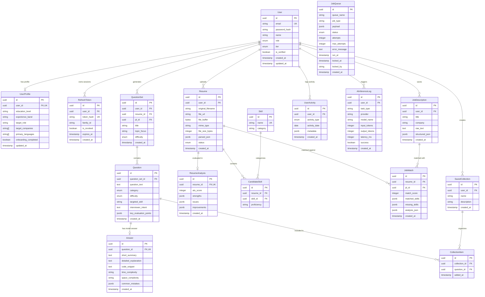

# TechQuery AI — Entity Relationships & Domain Data Model

**Document ID:** TQ-ARCH-003  
**Version:** 1.0.0 (System Design Phase)  
**Author:** Principal Database Architect & Systems Engineering Group  
**Status:** Approved for Implementation Planning  

---

## 1. Domain Entity Rationale & Scope

To maintain engineering discipline and prevent schema bloat, only entities strictly required for the approved V1 preparation platform (with clean extension hooks for V2/V3 simulation) are defined.

### 1.1 V1 Core Entities
1. **`User`:** Root identity and authentication anchor.
2. **`UserProfile`:** Candidate background, education level, target roles, and onboarding status.
3. **`RefreshToken`:** Secure session management with rotation and reuse detection.
4. **`Resume`:** Document metadata, raw file storage reference (or DB byte buffer), and parsed structured JSON.
5. **`ResumeAnalysis`:** ATS quality metrics, Google X-Y-Z bullet audits, and formatting health score.
6. **`JobDescription`:** Ingested job posting text and extracted technical competencies.
7. **`JobMatch`:** Hybrid deterministic-AI gap analysis scorecard comparing a specific Resume to a JD.
8. **`Skill`:** Canonical taxonomy dictionary (prevents duplicates like "ReactJS" vs "React.js").
9. **`CandidateSkill`:** Join table linking verified skills to a specific resume with proficiency tags.
10. **`QuestionSet`:** Grouping container for synthesized questions generated from a specific context.
11. **`Question`:** Individual interview question with category, difficulty, interviewer intent, and evaluation points.
12. **`Answer`:** Multi-tiered model answer, code snippets, and time/space complexity analysis.
13. **`SavedCollection`:** User-defined folders for bookmarking and organizing questions.
14. **`CollectionItem`:** Join entity mapping questions into collections.
15. **`UserActivity`:** Granular log of user actions powering the authentic streak and dashboard metrics.
16. **`JobQueue`:** PostgreSQL-backed queue powering reliable asynchronous processing in Cloud Mode.
17. **`AIInferenceLog`:** Telemetry log tracking model performance, latency, token usage, and costs.

---

## 2. Complete Entity-Relationship (ER) Diagram

---

## 3. Entity Responsibility & Ownership Specifications

### 3.1 Identity & Session Cluster
- **`User` (Root Entity):** Holds core credentials and permissions. Owns all user-generated assets.
- **`UserProfile`:** 1-to-1 relationship with `User`. Stores career preferences and progressive onboarding selections.
- **`RefreshToken`:** 1-to-many relationship with `User`. Implements token family tracking (`family_id`). If an already-consumed refresh token is replayed, the entire family is revoked, protecting against token theft.

### 3.2 Resume & JD Intelligence Cluster
- **`Resume`:** Represents an uploaded document. Supports dual storage modes: `file_url` (path string for local disk or Supabase) and `file_buffer` (optional bytea buffer for zero-external-storage cloud deployments).
- **`ResumeAnalysis`:** 1-to-1 relationship with `Resume`. Holds the compiled ATS scorecard, action verb analysis, and line-by-line Google X-Y-Z rewrite recommendations.
- **`JobDescription`:** Represents an ingested target job spec. Stores raw text and structured extracted skills.
- **`JobMatch`:** Junction entity linking a specific `Resume` to a specific `JobDescription`. Holds the calculated match score (0–100) and categorized missing competencies.

### 3.3 Question Studio & Learning Library Cluster
- **`QuestionSet`:** Groups questions generated in a single batch. Links optionally to the source `Resume` and `JobDescription` used as context.
- **`Question`:** Individual question entity with full schema attributes (intent, key evaluation criteria).
- **`Answer`:** 1-to-1 relationship with `Question`. Stores multi-tiered explanations and complexity metrics permanently in PostgreSQL.
- **`SavedCollection` & `CollectionItem`:** Many-to-many relationship allowing users to bookmark questions into custom revision folders (e.g., "Google SDE-1 Prep") and export to PDF.

### 3.4 Operational & System Cluster
- **`UserActivity`:** Indexed by `(user_id, activity_date)` to compute authentic daily preparation streaks and mastery counts for the Dashboard.
- **`JobQueue`:** PostgreSQL-backed queue table using atomic `FOR UPDATE SKIP LOCKED` row locking to manage asynchronous document parsing and question synthesis in Cloud Mode without requiring paid Redis services.
- **`AIInferenceLog`:** Comprehensive observability log tracking token efficiency, latency, and provider fallback events.
