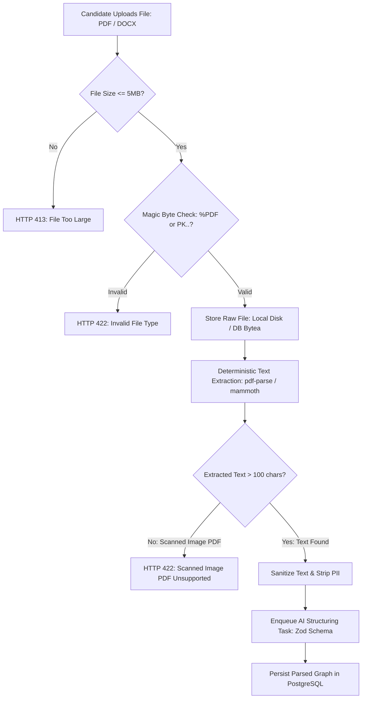

# TechQuery AI — File Processing & Document Ingestion Architecture

**Document ID:** TQ-ARCH-009  
**Version:** 1.0.0 (System Design Phase)  
**Author:** Principal Systems Architect & Backend Engineering Group  
**Status:** Approved for Implementation Planning  
**Operating Principle:** Secure, Zero-Cost Document Extraction Pipeline  

---

## 1. Supported Document Formats & Ingestion Pipeline

TechQuery AI processes unstructured candidate resumes and extracts structured profile data without requiring commercial OCR services.



---

## 2. Multi-Tier File Validation Protocols

### 2.1 File Size & Header Verification
- **Size Limit:** Max **5.0 MB** enforced via Express `multer` middleware before buffers reach memory.
- **MIME-Type Verification:** Inspected against `application/pdf`, `application/vnd.openxmlformats-officedocument.wordprocessingml.document`, and `text/plain`.

### 2.2 Magic Byte Inspection (Anti-Disguise Defense)
File extensions can be easily spoofed (e.g. an executable `.exe` renamed to `.pdf`). The ingestor inspects the file buffer header:
- **PDF Magic Bytes:** First 4 bytes must equal `%PDF` (`0x25 0x50 0x44 0x46`).
- **DOCX Magic Bytes:** First 4 bytes must equal the ZIP header `PK\x03\x04` (`0x50 0x4B 0x03 0x04`).

---

## 3. Deterministic Text Extraction Engines

### 3.1 PDF Extraction (`pdf-parse`)
- Utilizes the open-source `pdf-parse` library (Mozilla PDF.js wrapper) executing in-process.
- Operates on streaming memory buffers, extracting text streams page-by-page.
- Strips null bytes (`\0`) and non-printable control characters that could cause SQL insertion errors.

### 3.2 DOCX Extraction (`mammoth`)
- Utilizes open-source `mammoth` to extract raw text and basic paragraph structures from Microsoft Word XML documents.
- Preserves paragraph line breaks while stripping proprietary Office XML metadata.

### 3.3 Handling Scanned PDFs & OCR Strategy
- **Architectural Policy:** TechQuery AI **does not integrate paid OCR cloud APIs** (e.g. AWS Textract, Google Cloud Vision) to maintain the ₹0 project mandate.
- **Scanned Document Detection:** If the total extracted text from a multi-page PDF is less than 100 characters, the document is classified as a scanned image or flattened graphic.
- **Graceful Failure Protocol:** The system immediately aborts extraction and returns a friendly, actionable HTTP 422 response:
  > *"Scanned image PDFs are not supported. Please upload a native text-based PDF exported from Word, Google Docs, or Canva."*

---

## 4. Storage Architecture (Local vs Cloud Ephemeral Defense)

### 4.1 Storage Abstraction Contract
```typescript
export interface IStorageService {
  saveFile(userId: string, filename: string, buffer: Buffer, mimeType: string): Promise<{ fileUrl: string; fileBuffer?: Buffer }>;
  getFileBuffer(fileUrl: string, fallbackBuffer?: Buffer | null): Promise<Buffer>;
  deleteFile(fileUrl: string): Promise<boolean>;
}
```

### 4.2 Storage Implementation by Mode

| Mode | Storage Driver | Storage Location | Zero-Cost Feasibility & Data Retention |
| :--- | :--- | :--- | :--- |
| **Mode A (Localhost)** | `LocalStorageDriver` | `./uploads/resumes/:userId/:uuid.pdf` | **100% Free.** Persists permanently on local disk. Protected by Express auth routes. |
| **Mode B (Cloud Render)** | `DatabaseByteaDriver` | Stored directly in PostgreSQL column `resumes.file_buffer` | **100% Free.** Render's disk is ephemeral and wipes on restart. Storing the 250KB PDF buffer in Neon PostgreSQL guarantees permanent persistence with zero external S3 services. |
| **Mode B (Optional Cloud)** | `SupabaseStorageDriver` | Supabase Storage Free Tier (1GB) | **100% Free.** S3-compatible pre-signed URLs with zero credit card required. |
