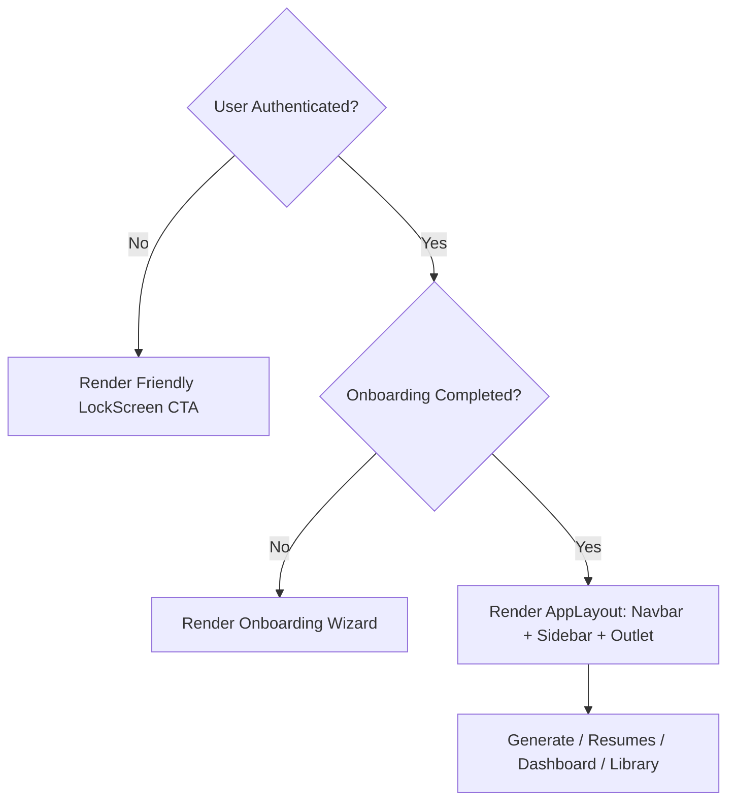

# TechQuery AI — Frontend Architecture & State Management Guide

**Document ID:** TQ-ARCH-012  
**Version:** 1.0.0 (System Design Phase)  
**Author:** Senior Frontend Architect & UI Systems Engineer  
**Status:** Approved for Implementation Planning  
**Stack:** React 19, TypeScript, Vite 7, Tailwind CSS v4, TanStack Query, Zod  

---

## 1. Architectural Style: Feature-Sliced Architecture

To prevent spaghetti code and maintain clear module boundaries, the frontend is organized by **Feature Modules**:

```
frontend/src/
├── app/                  # Application root, providers, routing
│   ├── App.tsx
│   ├── router.tsx
│   └── providers.tsx
├── assets/               # Static images, icons, fonts
├── components/           # Shared, domain-agnostic UI components
│   ├── ui/               # shadcn/ui primitives (button, dialog, card, tabs)
│   ├── feedback/         # Toast, alert, modal, empty-state, skeleton
│   └── layout/           # Navbar, Sidebar, Footer, PageHeader
├── features/             # Feature-sliced domain modules
│   ├── auth/             # Login, Register, VerifyEmail, AuthContext
│   ├── onboarding/       # Multi-step profile wizard
│   ├── resumes/          # ResumeUpload, ResumeList, ATSScoreCard
│   ├── jd/               # JDInput, JDDecompositionView
│   ├── matching/         # MatchScoreCard, SkillGapReport
│   ├── questions/        # QuestionStudio, QuestionCard, AnswerDrawer
│   ├── library/          # CollectionsView, PDFExportModal
│   ├── dashboard/        # StreakMatrix, MetricCards, ActivityFeed
│   └── coding/           # MonacoEditor, PyodideConsole, TestResults
├── hooks/                # Global utility hooks (useDebounce, useMediaQuery)
├── lib/                  # Centralized client configuration
│   ├── api.ts            # Axios instance with interceptors
│   ├── queryClient.ts    # TanStack Query client configuration
│   └── utils.ts          # Classname merger (cn)
├── types/                # Global TypeScript contracts
└── workers/              # In-browser Web Workers
    └── pythonRunner.worker.ts  # Pyodide WebAssembly execution worker
```

---

## 2. Server State vs Client State Management

```mermaid
flowchart TD
    subgraph Client State (React Context)
        AuthContext[AuthContext: accessToken, user profile, role]
        ThemeContext[ThemeContext: light/dark mode preference]
    end

    subgraph Server State (TanStack Query v5)
        Q1[useQuery: ['resumes']]
        Q2[useQuery: ['resume', id, 'analysis']]
        Q3[useQuery: ['questionSets', id]]
        Q4[useQuery: ['dashboard', 'summary']]
        M1[useMutation: uploadResumeMutation]
        M2[useMutation: generateQuestionsMutation]
    end

    subgraph Form State (React Hook Form + Zod)
        F1[RegisterForm]
        F2[LoginForm]
        F3[OnboardingWizardForm]
        F4[JDInputForm]
    end

    subgraph In-Browser Web Worker (Pyodide WebAssembly)
        W1[Python Code String] --> W2[pythonRunner.worker.ts]
        W2 --> W3[Standard Output + Execution Metrics]
    end
```

### 2.1 Server State with `@tanstack/react-query`
- All remote data fetching, caching, and cache invalidation route through TanStack Query.
- **Cache Policy:** Stale time of 5 minutes (`staleTime: 1000 * 60 * 5`) for static entities (parsed resumes, saved questions); automatic cache invalidation (`queryClient.invalidateQueries`) upon successful mutations.
- **Optimistic Updates:** Toggling collection bookmarks updates the client UI immediately (< 16ms), rolling back only if the server returns an error.

### 2.2 Form Handling with `react-hook-form` & Zod
- Forms use uncontrolled components via `react-hook-form` to eliminate re-renders on keystrokes.
- Client-side validation uses identical Zod schemas to the backend API (`@hookform/resolvers/zod`), guaranteeing instant inline feedback.

---

## 3. Centralized API Client & Cloud Keep-Warm Interceptor

```typescript
// src/lib/api.ts
import axios from "axios";

export const api = axios.create({
  baseURL: import.meta.env.VITE_API_URL || "/api/v1",
  timeout: 15000,
  withCredentials: true, // Sends HttpOnly refreshToken cookie automatically
});

// Request Interceptor: Attach Access Token
api.interceptors.request.use((config) => {
  const token = getAccessTokenFromMemory();
  if (token) {
    config.headers.Authorization = `Bearer ${token}`;
  }
  return config;
});

// Response Interceptor: Auto-Refresh & Cloud Warmup Handling
api.interceptors.response.use(
  (response) => response,
  async (error) => {
    const originalRequest = error.config;

    // Handle Expired Access Token (401)
    if (error.response?.status === 401 && !originalRequest._retry) {
      originalRequest._retry = true;
      try {
        const { data } = await api.post("/auth/refresh");
        setAccessTokenInMemory(data.data.accessToken);
        originalRequest.headers.Authorization = `Bearer ${data.data.accessToken}`;
        return api(originalRequest);
      } catch (refreshErr) {
        window.dispatchEvent(new CustomEvent("auth:session-expired"));
        return Promise.reject(refreshErr);
      }
    }

    return Promise.reject(error);
  }
);
```

---

## 4. Protected Route & Layout Architecture



- **`ProtectedRoute.tsx`:** Inspects in-memory auth state. If unauthenticated, displays an informative `LockScreen` component with a direct login button, preserving navigation intent via `state: { from: location }`.
- **`AppLayout.tsx`:** Responsive shell containing sticky Navbar, collapsible sidebar, global breadcrumb navigation, and an active preparation streak badge.

---

## 5. UI/UX Visual Specification Note

> **IMPORTANT ARCHITECTURAL RULE:**  
> This document specifies structural interfaces, state stores, and component hierarchies only. **Visual designs, color palettes, animations, and typography choices are handled in a separate phase.** Before frontend implementation begins, the engineering team will review visual references and approve a formal design system.
