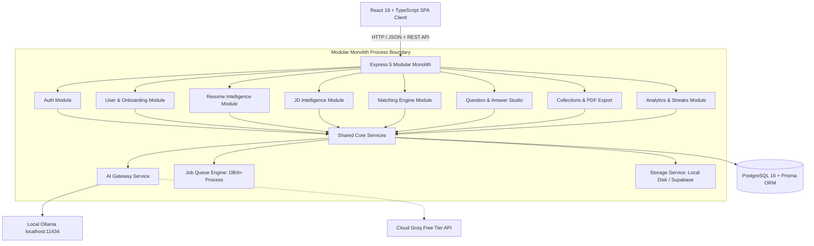
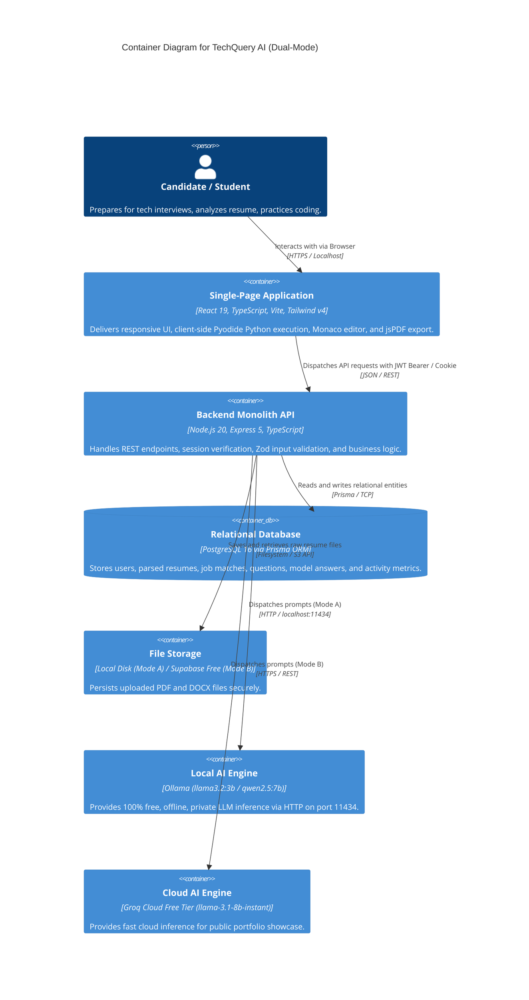
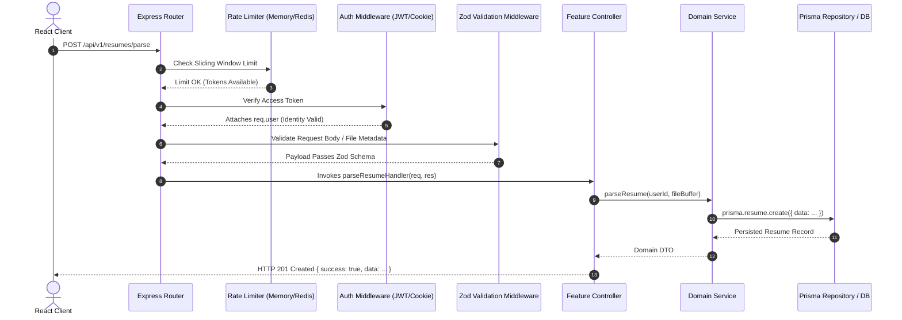
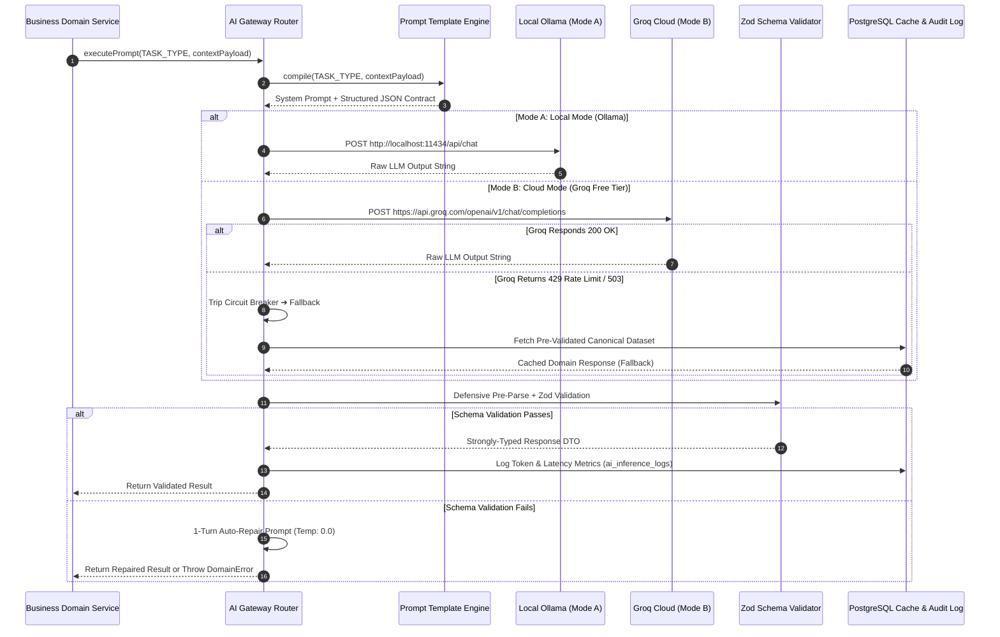

# TechQuery AI — System Architecture & Technical Blueprint

**Document ID:** TQ-ARCH-001  
**Version:** 1.0.0 (System Design Phase)  
**Author:** Principal Software Architect & Systems Engineering Group  
**Status:** Approved for Implementation Planning  
**Operating Principle:** Dual-Mode Architecture (Local-First Primary, Cloud Secondary) at Strictly ₹0  

---

## 1. System Overview

TechQuery AI is an intelligent, unified career acceleration and technical interview preparation platform. It synthesizes three interconnected product vectors into a single candidate data graph:
1. **AI Technical Interview Preparation Studio:** Multi-format resume parsing (PDF/DOCX), semantic job description (JD) decomposition, hybrid deterministic-AI skill-gap analysis, context-aware question synthesis, and model answer generation.
2. **AI Career Preparation & Employability Engine:** ATS resume auditing via the Google X-Y-Z formula, missing skill detection, sprint-based learning roadmaps, and authentic database-tracked preparation streaks.
3. **AI Technical Interview Simulator:** Adaptive conversational mock interviews with context-aware follow-up probes, multi-dimensional rubric evaluations citing transcript evidence, and client-side sandboxed Python execution.

---

## 2. Architecture Style & Justification: Modular Monolith

### 2.1 The Decision
TechQuery AI is engineered as a **Modular Monolith** using TypeScript on Node.js (Express 5).



### 2.2 Technical Justification
1. **Zero-Cost & 512MB RAM Constraint:** Microservices require multiple runtime containers, service meshes, and distributed logging infrastructure that immediately exceed free cloud quotas (Render 512MB RAM cap). A Modular Monolith runs as a single lightweight Node.js process using ~120MB–180MB RAM.
2. **Zero Operational Overhead:** Eliminates network serialization latency, distributed transaction orchestration (Saga patterns), and inter-service networking failures.
3. **Strict Domain Encapsulation:** Modules maintain strict directory isolation (`src/modules/*`), exposing public service interfaces and internal data models. If an individual module (e.g., Code Execution) later requires independent scaling, it can be extracted with zero business logic refactoring.

---

## 3. High-Level Component & Container Architecture

### 3.1 C4 Container Diagram



---

## 4. Frontend Architecture

- **Technology Foundation:** React 19, TypeScript, Vite 7, Tailwind CSS v4, `@tailwindcss/vite`, `shadcn/ui`, `framer-motion`.
- **Client-Side State Management:**
  - **Server Cache & Async Queries:** `@tanstack/react-query` manages server synchronization, optimistic UI updates, window re-focus re-fetching, and cache invalidation.
  - **Form State & Schema Validation:** `react-hook-form` coupled with `@hookform/resolvers/zod` for zero-re-render form controls and client-side validation.
  - **Auth & Session State:** React Context (`AuthContext`) managing short-lived in-memory access tokens, refresh loops, and user profile state.
- **Client-Side Execution Engine:**
  - **Python Execution:** **Pyodide (WebAssembly)** loaded inside a dedicated Web Worker (`src/workers/pythonRunner.worker.ts`), providing 100% isolated algorithmic code execution with zero server compute overhead.
  - **JavaScript Execution:** Native Web Worker sandbox with disabled DOM access (`self.postMessage` only) and 2.0s execution timeout guards.
  - **Document Generation:** `jsPDF` executing in-browser memory to compile multi-page, syntax-highlighted PDF revision sheets without backend load.

---

## 5. Backend Architecture & Request Lifecycles

### 5.1 Standard REST API Request Lifecycle



### 5.2 AI Inference Request Lifecycle & Fallback Chain



---

## 6. Background Job & Asynchronous Processing

To prevent request timeouts on long-running tasks (multi-page document parsing, 20-question generation sets), TechQuery AI employs an **asynchronous queue architecture** tailored to the operating mode:
- **Mode A (Localhost):** In-process job runner or local BullMQ worker backed by local Redis.
- **Mode B (Cloud Deployment on Render):** **PostgreSQL-Backed Job Table (`JobQueue`)** using atomic row claiming:
  ```sql
  UPDATE job_queue
  SET status = 'PROCESSING', locked_at = NOW(), locked_by = :workerId
  WHERE id = (
    SELECT id FROM job_queue
    WHERE status = 'PENDING' AND run_at <= NOW()
    ORDER BY priority DESC, created_at ASC
    LIMIT 1
    FOR UPDATE SKIP LOCKED
  )
  RETURNING *;
  ```
  This eliminates external Redis command polling entirely, preventing Upstash free quota exhaustion while guaranteeing at-least-once execution.

---

## 7. Storage Layer Architecture

- **Abstraction Interface:** All document access routes through `StorageService` (`uploadFile`, `getFileStream`, `deleteFile`, `getSignedUrl`).
- **Mode A Implementation (`LocalStorageDriver`):**
  - Stores files in `./uploads/resumes/:userId/:fileId.pdf`.
  - Served via Express static middleware with strict authentication guards (`protect` middleware).
- **Mode B Implementation (`DatabaseByteaDriver` / `SupabaseStorageDriver`):**
  - **Zero-Credit-Card Primary:** Files stored directly as compressed binary buffers in the PostgreSQL `resumes.file_buffer` column. A standard 250KB PDF occupies ~0.25MB; 100 test resumes require 25MB, well within Neon/Supabase 500MB free database allocations.
  - **Secondary:** Supabase Storage Free Tier (1GB S3-compatible, no credit card required).

---

## 8. Trust Boundaries & Security Enclaves

```mermaid
flowchart TD
    subgraph Untrusted Public Zone
        Internet[Public Web / Untrusted Clients]
    end

    subgraph Perimeter Enclave (Vercel Edge / Reverse Proxy)
        SSL[TLS Termination & Static Asset Delivery]
        CORS[CORS Policy Guard: Origin Whitelist]
    end

    subgraph Application Security Zone (Node.js API Monolith)
        RateLimit[Sliding Window Rate Limiter]
        AuthGuard[JWT Auth & Cookie Guard]
        TenantGuard[Tenant Isolation Enforcement: user_id check]
        ZodSanitizer[Input Sanitizer & Zod Validator]
    end

    subgraph Data & Compute Enclave (Internal Network)
        Postgres[(PostgreSQL 16: Parameterized Prisma Access)]
        LocalOllama[Ollama Localhost:11434 - Non-Exposed]
        LocalDisk[Storage Directory: Non-Executable]
    end

    Internet --> SSL
    SSL --> CORS
    CORS --> RateLimit
    RateLimit --> AuthGuard
    AuthGuard --> TenantGuard
    TenantGuard --> ZodSanitizer
    ZodSanitizer --> Postgres
    ZodSanitizer --> LocalOllama
    ZodSanitizer --> LocalDisk
```

1. **Perimeter Boundary:** The client cannot communicate directly with the database or Ollama. All interactions pass through Express middleware enforcing CORS, rate limits, and authentication.
2. **Tenant Isolation Boundary:** Every repository query mutating or reading data enforces `WHERE id = :id AND user_id = :authenticatedUserId`. Object ID guessing attacks (BOLA / IDOR) are impossible.
3. **Execution Sandbox Boundary:** Python code executed during coding practice runs inside the client's browser Web Worker via Pyodide WebAssembly. The code has zero network access, zero DOM access, and zero backend server interaction.
